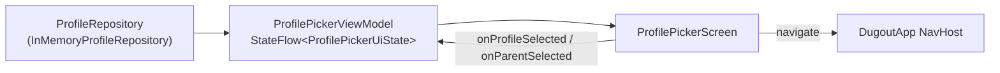

# App structure

Dugout TV is a single Android application module (`:app`, package `tv.dugout`) written in
Kotlin with Jetpack Compose for TV ([ADR-0001](../adr/0001-kotlin-gradle-compose-for-tv.md)).

## Packages

```text
app/src/main/kotlin/tv/dugout/
├── MainActivity.kt          # composition root: wires the repository into DugoutApp
├── DugoutApp.kt             # NavHost and routes
├── profile/                 # Profile, ProfileRepository, InMemoryProfileRepository
├── picker/                  # ProfilePickerViewModel and ProfilePickerScreen
├── home/                    # HomePlaceholderScreen (until the home screen spec)
├── parent/                  # ParentPlaceholderScreen (until the parent settings spec)
└── ui/theme/                # color tokens, DugoutTheme, DugoutBackground
```

Tests mirror the packages: JVM and Robolectric tests in `app/src/test`, emulator
acceptance tests in `app/src/androidTest`
([ADR-0003](../adr/0003-testing-and-coverage-standard.md)).

## Data flow

Data reaches a screen through a repository interface and a ViewModel. Screens are
stateless: they render a UI state and report events through callbacks.



- `ProfileRepository` is the boundary. The in-memory implementation holds the two
  default profiles until persistence exists; tests substitute their own.
- `ProfilePickerViewModel` owns the picker state, including `lastSelection`, which lets
  the screen put focus back on the item that was chosen when the user presses Back.
- The ViewModel is scoped to the picker's back stack entry, so it survives a trip to a
  placeholder screen and back.

## Navigation

| Route | Screen | Back goes to |
|-------|--------|--------------|
| `picker` (start) | Profile picker | leaves the app |
| `home/{profileId}` | Home placeholder, "Hi, Sam" | picker, focus on that profile |
| `parent` | Parent placeholder | picker, focus on the parent button |

Navigation uses `launchSingleTop`, so pressing select twice quickly never stacks two
copies of a screen. An unknown `profileId` returns to the picker.

## Focus

Every screen must be fully usable with a D-pad. On the picker, focus starts on the last
selection if there is one, otherwise the first profile, otherwise the parent button, so
the remote is never left with nothing focused. Focused items show a 4dp gold
(`#FFD23F`) outline and scale to 1.06, as in [the mockup](../mockups/tv-mockup.html).
