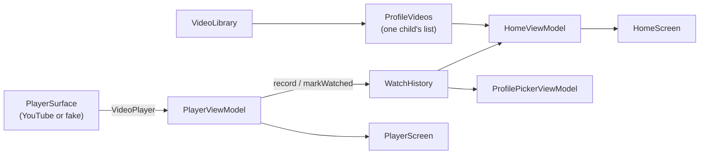
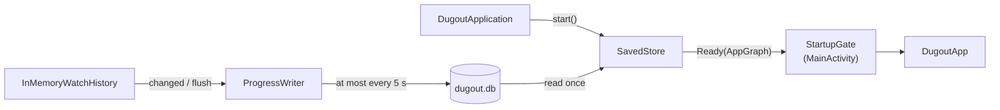

# App structure

Dugout TV is a single Android application module (`:app`, package `tv.dugout`) written in
Kotlin with Jetpack Compose for TV ([ADR-0001](../adr/0001-kotlin-gradle-compose-for-tv.md)).

## Packages

```text
app/src/main/kotlin/tv/dugout/
├── MainActivity.kt          # composition root: waits for saved data, saves on stop
├── StartupGate.kt           # blank until loaded, or the error message if loading failed
├── AppGraph.kt              # the shared data sources and the player surface
├── DugoutApp.kt             # NavHost, routes, and the result handoff back to Home
├── library/                 # Video, Skill, Level, AgeRange, recommendations, VideoLibrary, ProfileVideos
├── history/                 # WatchHistory, WatchProgress rules, InMemoryWatchHistory, ProgressSink
├── profile/                 # Profile, ProfileRepository (add a child), ProfileSaver, avatar colors
├── storage/                 # Room database, migrations, SavedStore, throttled ProgressWriter
├── picker/                  # ProfilePickerViewModel and ProfilePickerScreen (with the add tile)
├── setup/                   # SetupViewModel and the "Add a player" wizard screens
├── home/                    # HomeViewModel, focus return rules, HomeScreen, cards, tabs
├── player/                  # VideoPlayer seam, PlayerViewModel, PlayerScreen, YouTube adapter
├── upnext/                  # next video rule and UpNextScreen
├── parent/                  # ParentPlaceholderScreen (until the parent settings spec)
└── ui/theme/                # color tokens, DugoutTheme, DugoutBackground
```

Tests mirror the packages: JVM and Robolectric tests in `app/src/test`, emulator
acceptance tests in `app/src/androidTest`, and the sample children both use in
`app/src/sharedTest`
([ADR-0003](../adr/0003-testing-and-coverage-standard.md)).

## Data flow

Data reaches a screen through interfaces gathered in `AppGraph` and a ViewModel per
screen. Screens are stateless: they render a UI state and report events through
callbacks. Tests build their own graph (`testGraph()`) with in-memory parts and a fake
player.



- `ProfileVideos` decides which videos a child sees. The setup wizard (spec
  [0004](../specs/0004-setup-wizard/spec.md)) chooses each child's list, pre-checking
  videos whose level and ages match the child (`isRecommendedFor`).
- `ProfileRepository` exposes the children as a `StateFlow`. `add` saves a child and
  their list through a `ProfileSaver` (one Room transaction), then updates memory, so the
  picker shows the new child at once.
- `WatchHistory` holds each child's progress. A video is watched at 90% of its length,
  or when it ends; it counts as started at 10 seconds. `InMemoryWatchHistory` serves
  progress from memory and reports each change to a `ProgressSink`.
- `PlayerViewModel` talks to the player only through `VideoPlayer`, so the YouTube
  adapter ([ADR-0006](../adr/0006-youtube-embedded-player.md)) can be swapped for a fake.

## Saved data

Profiles, each child's video list, and watch progress live in a Room database,
`dugout.db` ([ADR-0007](../adr/0007-room-for-saved-data.md), spec
[0003](../specs/0003-saving/spec.md)). The bundled library stays in code; saved rows
refer to videos by ID.



- `SavedStore` opens the database off the main thread, reads all of it into memory, and
  builds the `AppGraph` from in-memory parts. Until then `StartupGate` shows a blank
  background, so no screen (including one Android restores after the process was
  killed) reads a half-filled store. If loading fails it shows an error message.
- A brand-new database starts empty, so a fresh install opens the setup wizard. Tests
  can seed one (`Seed`); `SampleDugoutApplication` does so for tests that launch the real
  `MainActivity`.
- Version 2 added each child's age range and level; `MIGRATION_1_2` gives children saved
  by version 1 "9 to 10, kid pitch".
- `ProgressWriter` saves a playing video's progress at most every 5 seconds, and at once
  when a video ends, when the child leaves the player, and when the activity stops.
- Progress for a video no longer in the library is dropped on load.
- The schema is exported to `app/schemas/`. Any change needs a new version and a tested
  migration.

## Navigation

| Route | Screen | Back goes to |
|-------|--------|--------------|
| `picker` (start) | Profile picker | leaves the app |
| `setup` (start with no children) | Add a player wizard | the previous step; on the first step and the ready screen, the picker (or leaves the app with no children) |
| `home/{profileId}` | Home: skill tabs, rows of cards | picker, focus on that profile |
| `player/{profileId}/{videoId}` | Player | Home, focus on that video |
| `upnext/{profileId}/{videoId}` | Up next, after a video ends | Home, focus on that video |
| `parent` | Parent placeholder | picker, focus on the parent button |

When a video ends, the player replaces itself with Up next. "Play next" replaces Up
next with a new player, so Back always lands on Home. The player and Up next tell Home
which video was last played (and, for "Back to <Skill>", which skill tab to open) through
Home's back stack entry (`RESULT_LAST_VIDEO`, `RESULT_OPEN_SKILL`). The wizard tells the
picker which child it added (`RESULT_ADDED_PROFILE`), so focus lands on them; "Start
watching" puts the picker beneath the new child's Home, even on a fresh install.

The picker navigates only while it is the current destination, and Home opens a video
only once its entry is resumed, so pressing select twice quickly never stacks screens.
An unknown `profileId` returns to the picker.

## Focus

Every screen must be fully usable with a D-pad. Focused items show a gold (`#FFD23F`)
outline and scale to 1.06, as in [the mockup](../mockups/tv-mockup.html).

- **Picker:** the last selection if there is one, otherwise the first profile, otherwise
  the parent button.
- **Home:** the first card on arrival, or the Home tab when the child has no videos.
  Entering the tab row from below lands on the selected tab; a tab switches content when
  it gains focus. After a video, focus returns to that video in the row it was started
  from, else in its own skill row (`focusAfterReturn`).
- **Player:** Play/Pause. The YouTube view blocks descendant focus, so the remote never
  enters it.
- **Up next:** Play next, or Back to <Skill> when the skill has no other video.
