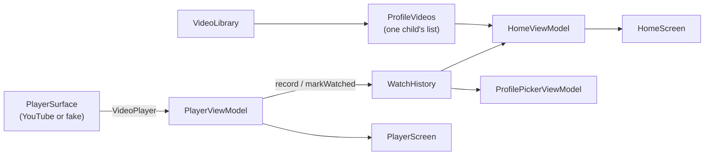

# App structure

Dugout TV is a single Android application module (`:app`, package `tv.dugout`) written in
Kotlin with Jetpack Compose for TV ([ADR-0001](../adr/0001-kotlin-gradle-compose-for-tv.md)).

## Packages

```text
app/src/main/kotlin/tv/dugout/
├── MainActivity.kt          # composition root: builds the AppGraph
├── AppGraph.kt              # the shared data sources and the player surface
├── DugoutApp.kt             # NavHost, routes, and the result handoff back to Home
├── library/                 # Video, Skill, VideoLibrary (31 bundled videos), ProfileVideos
├── history/                 # WatchHistory, WatchProgress rules, InMemoryWatchHistory
├── profile/                 # Profile, ProfileRepository, sample profiles
├── picker/                  # ProfilePickerViewModel and ProfilePickerScreen
├── home/                    # HomeViewModel, focus return rules, HomeScreen, cards, tabs
├── player/                  # VideoPlayer seam, PlayerViewModel, PlayerScreen, YouTube adapter
├── upnext/                  # next video rule and UpNextScreen
├── parent/                  # ParentPlaceholderScreen (until the parent settings spec)
└── ui/theme/                # color tokens, DugoutTheme, DugoutBackground
```

Tests mirror the packages: JVM and Robolectric tests in `app/src/test`, emulator
acceptance tests in `app/src/androidTest`
([ADR-0003](../adr/0003-testing-and-coverage-standard.md)).

## Data flow

Data reaches a screen through interfaces gathered in `AppGraph` and a ViewModel per
screen. Screens are stateless: they render a UI state and report events through
callbacks. Tests build their own graph (`testGraph()`) with in-memory parts and a fake
player.



- `ProfileVideos` decides which videos a child sees. Every child gets the whole library
  until the setup wizard (spec 0004) chooses per-child lists.
- `WatchHistory` holds each child's progress. A video is watched at 90% of its length,
  or when it ends; it counts as started at 10 seconds. The in-memory implementation
  resets when the app process ends, until spec 0003 saves it.
- `PlayerViewModel` talks to the player only through `VideoPlayer`, so the YouTube
  adapter ([ADR-0006](../adr/0006-youtube-embedded-player.md)) can be swapped for a fake.

## Navigation

| Route | Screen | Back goes to |
|-------|--------|--------------|
| `picker` (start) | Profile picker | leaves the app |
| `home/{profileId}` | Home: skill tabs, rows of cards | picker, focus on that profile |
| `player/{profileId}/{videoId}` | Player | Home, focus on that video |
| `upnext/{profileId}/{videoId}` | Up next, after a video ends | Home, focus on that video |
| `parent` | Parent placeholder | picker, focus on the parent button |

When a video ends, the player replaces itself with Up next. "Play next" replaces Up
next with a new player, so Back always lands on Home. The player and Up next tell Home
which video was last played (and, for "Back to <Skill>", which skill tab to open) through
Home's back stack entry (`RESULT_LAST_VIDEO`, `RESULT_OPEN_SKILL`).

The picker navigates only while it is the current destination, and Home opens a video
only once its entry is resumed, so pressing select twice quickly never stacks screens.
An unknown `profileId` returns to the picker.

## Focus

Every screen must be fully usable with a D-pad. Focused items show a gold (`#FFD23F`)
outline and scale to 1.06, as in [the mockup](../mockups/tv-mockup.html).

- **Picker:** the last selection if there is one, otherwise the first profile, otherwise
  the parent button.
- **Home:** the first card on arrival, or the Home tab when the child has no videos.
  Entering the tab row from below lands on the selected tab; a tab switches content when
  it gains focus. After a video, focus returns to that video in the row it was started
  from, else in its own skill row (`focusAfterReturn`).
- **Player:** Play/Pause. The YouTube view blocks descendant focus, so the remote never
  enters it.
- **Up next:** Play next, or Back to <Skill> when the skill has no other video.
