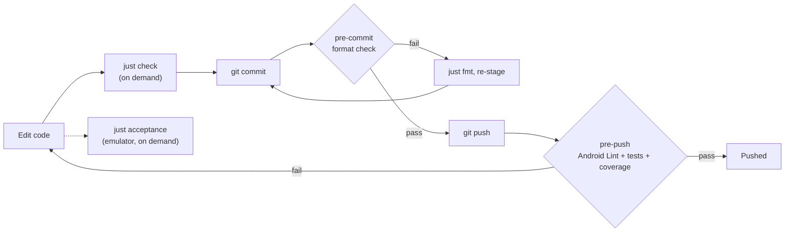

# Development workflow

The inner loop, the quality gates, and how to put a build on a real Google TV. The tool
choices are recorded in [ADR-0002](../adr/0002-just-task-runner.md) to
[ADR-0005](../adr/0005-prek-git-hooks.md).

## The inner loop

1. Install the hooks once per clone: `just hooks`.
2. Write a failing test, then the code that makes it pass.
3. Run `just test` for fast feedback, and `just fmt` to format.
4. Run `just acceptance` when a change touches focus, navigation, or anything a remote
   drives.
5. Run `just check` before pushing to reproduce the hook gate locally.
6. Commit; the format check runs. Push; Android Lint and the tests run.

## Quality gates



| Check | Recipe | prek stage |
|-------|--------|------------|
| Spotless (ktlint) format check | `just lint` | pre-commit |
| Android Lint, warnings as errors | `just lint-android` | pre-push |
| Unit and Robolectric tests, 90% coverage, screenshots match | `just test` | pre-push |
| Acceptance on the Google TV emulator | `just acceptance` | none (on demand) |

There is no CI yet; the hooks and `just check` are the gate.

## Screenshot tests

Some Robolectric tests capture a screen with Roborazzi and compare it with a reference
image in `app/src/test/screenshots/`, so a change to what the game's diamond draws fails
`just test`. After a change that is meant to look different, run `just screenshots` to
re-record the references, look at the new images, and commit them with the change. A
failed comparison writes the actual and diff images under `app/build/outputs/roborazzi/`.

## Acceptance tests

`just acceptance` needs no running emulator. `scripts/acceptance.sh` creates the
`dugout-acceptance` AVD from `system-images;android-34;google-tv;arm64-v8a` if it is
missing, cold boots it headless on its own port (5584), runs the suite against that
emulator only, and shuts it down even when tests fail or the run is interrupted. It stops
with an error, touching nothing, if something already runs on that port, and fails with
the tail of `build/acceptance-emulator.log` if the emulator exits or does not boot within
five minutes. Install the image once with:

```sh
sdkmanager "system-images;android-34;google-tv;arm64-v8a"
```

## Deploying to a Google TV

Device details (IP address, serial, model) never go in a tracked file. Pass them on the
command line or keep them in a local `.env`, which is gitignored (copy `.env.example`).

1. On the TV, open Settings, then System, then About, and select **Android TV OS build**
   seven times to enable developer options.
2. Open Settings, then System, then Developer options, and turn on debugging. Newer
   Google TV devices offer **Wireless debugging**; older ones offer **USB debugging** with
   network access on port 5555.
3. Connect adb to the TV:
   - **Wireless debugging:** open it on the TV, choose **Pair device with pairing code**,
     and run `just tv-pair <tv-ip>:<pairing-port>` with the code it shows. Then run
     `just tv-connect <tv-ip>:<port>` using the address on the Wireless debugging screen
     (the connect port differs from the pairing port).
   - **Port 5555:** find the IP under Settings, then Network and Internet, run
     `just tv-connect <tv-ip>`, and accept the prompt on the TV.

   To skip typing the address, set `DUGOUT_TV_IP` (`<tv-ip>` or `<tv-ip>:<port>`) in
   `.env` and run `just tv-connect`.
4. Install and launch: `just install <serial>`, where the serial is the address
   `adb devices` lists for the TV. With only the TV connected, `just install` alone finds
   it. With several devices connected, it stops and lists them rather than installing on
   all of them.

Menu names vary slightly between Google TV devices.
