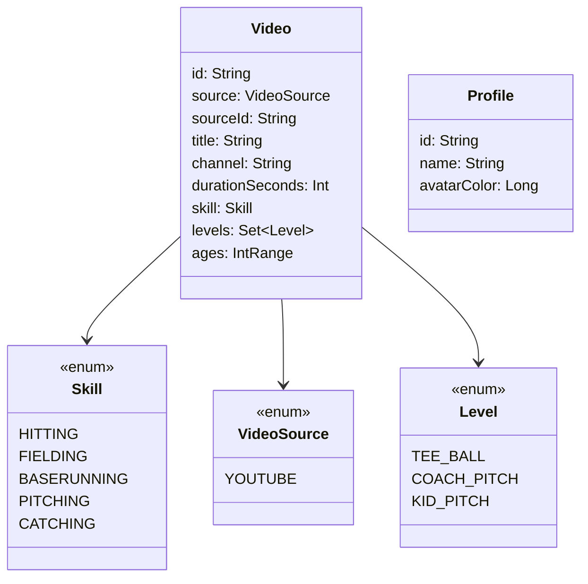
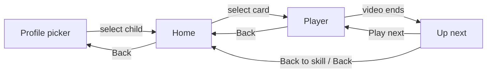

# Design: video library, home screen, and player

- **Date:** 2026-10-25
- **Status:** Accepted

## Intent

After [0001](../0001-project-scaffold/spec.md), picking a profile lands on a placeholder.
This spec makes the app usable end to end on a TV: a child picks their profile, browses
their approved baseball videos by skill, sees how far they have gotten, and watches a
video in the app's own player with slow-mo, then moves on to the next video in that skill
without YouTube suggestions.

The kids come to the home screen to see what videos are available and to track their
progress (the owner's words). Pride should come from finishing skills, not from showing up
every day.

Dugout TV is meant for any family, not one household. Profile names, the number of
children, and each child's video list must not be assumed anywhere outside sample data.
Later specs add saving (0003) and a per-child setup wizard (0004); this spec shapes the
data so both plug in without rework.

## Goals

1. A library of 31 owner-approved videos across five skills, each tagged with the levels
   and ages it suits.
2. A home screen per child: a tab per skill with that child's progress, rows of video
   cards, and a "Keep watching" row.
3. A player built on YouTube's embedded player, driven entirely by the remote, with
   pause, back 10 seconds, and 0.5× slow-mo.
4. An "Up next in <skill>" screen when a video ends, so YouTube's suggestions never show.
5. Watched tracking (at least 90% viewed) that drives green checks and per-skill counts
   for the current session.
6. Focus that starts somewhere sensible and returns to the chosen card after Back, on
   every screen.

## Non-goals

- Saving anything across app restarts. Watched state, positions, and profiles live in
  memory and reset when the app process ends. Saving is spec 0003.
- Creating, editing, or deleting profiles, and choosing videos per child. That is the
  setup wizard, spec 0004.
- Parent settings and the PIN. The parent entry on the picker stays a placeholder.
- My List. The tab exists and shows a "coming soon" message; the player has no "Add to
  My List" button yet.
- Videos for ages or levels other than kid pitch, 9 to 12. The library grows in 0004.
- Non-YouTube video sources. The data model allows them; nothing plays them yet.

## Anti-goals

- **No streaks**, and nothing that pressures a child to come back daily (the owner's
  call). No autoplay countdown on the "Up next" screen.
- Anything drawn over the YouTube player, including our controls or progress bar. This
  breaks YouTube's required minimum functionality.
- Remote focus entering the YouTube player's WebView, where it becomes invisible.
- Hiding or blocking YouTube's own UI, ads, or links beyond what the research note
  accepts (unloading captions).
- Downloading, caching, or extracting YouTube streams, or scraping YouTube pages from
  the app.
- Hard-coding the sample profiles anywhere outside the sample repository.
- Reaching the 90% coverage floor by excluding screens or logic.

## Constraints

- The playback approach, its rules, and the spike's findings are in
  [the video playback research note](../../research/video-playback.md). Read it before
  touching the player.
- The YouTube embed's viewport must be at least 200×200 px; autoplay only when more than
  half the player is visible.
- The TV reports 960dp of width at 1080p, so mockup pixel sizes halve in dp.
- Everything in [AGENTS.md](../../../AGENTS.md) applies: test first, remote first, state
  in ViewModels, data through repository interfaces, writing style, no device details.

## Decided by the owner

- Five skills, in this order: Hitting, Fielding, Baserunning, Pitching, Catching. My
  List follows them as a sixth tab.
- Every video is under 15 minutes and speaks to the player rather than to coaches where
  possible.
- The 31 videos in [the library](#the-library) below, chosen from 35 candidates.
- Progress appears on the skill tabs themselves (layout A): each tab shows "N of M" and a
  thin bar, and a finished skill's tab turns green.
- No streak.
- The player is part of this spec; selecting a card plays the video.
- Progress resets on restart until spec 0003.
- The app is generic: any parent, any number of children, each child with their own
  video list. Profiles get created through a setup wizard in 0004.
- Playback: YouTube's embedded player through android-youtube-player, controls below the
  video, player focus blocked, captions unloaded, creator end-screen cards allowed to show.

## The how

Marked *(owner)* where the owner decided; everything else is the designer's call and the
builder may change it with a reason.

### Data model

- `VideoLibrary` (interface): every video the app knows, in display order. The first
  implementation is a bundled Kotlin list. A JSON asset is equally fine.
- `ProfileVideos` (interface): the video IDs one child may watch. Home reads a child's
  videos only through this, so the 0004 wizard can supply per-child lists. In this spec,
  each sample profile gets every video in the library.
- `WatchHistory` (interface, in memory for now): per profile and video, the furthest
  position reached, the last position, the duration, and when it was last played. A video
  is **watched** once the furthest position reaches 90% of its duration *(owner, via the
  mockup)*. Watched never reverts within a session. Spec 0003 swaps in a saved
  implementation behind the same interface.
- `Profile.watchedCount` goes away. The picker's "N watched" label comes from
  `WatchHistory`, so it shows 0 at launch.
- `ProfileRepository` keeps its role. The in-memory sample profiles stay as sample data:
  two children with distinct avatar colors. Their names live only in the sample
  repository and in tests.

### The library

All 31 videos are YouTube videos, levels `KID_PITCH`, ages 9 to 12. Order within each
skill is display order. Titles are cleaned up for the TV, and the card's source badge is
the channel name in capitals. All were checked on 2026-10-25 to be embeddable,
family-safe, and under 15 minutes.

| Skill | YouTube ID | Title | Channel | Length |
| --- | --- | --- | --- | --- |
| Hitting | `TjH37PpeX7k` | The Alligator Arms Swing Drill | Alex Rodriguez | 3:13 |
| Hitting | `ocJ8O_Rs6Es` | Approach to Hitting | SKLZ Baseball | 2:37 |
| Hitting | `ylfNFzwBRrA` | Hitting Stance in Kid Pitch | SKLZ | 2:02 |
| Hitting | `fPRAqPcEPYA` | 5 Essential Hitting Drills | Jermaine Curtis | 7:34 |
| Hitting | `pRjscfWpdMw` | 3 Essential Hitting Drills for Kids | Ultimate Baseball Training | 6:23 |
| Hitting | `XMO6GBFACTU` | Why Practice with a Tee | SKLZ Baseball | 3:01 |
| Hitting | `_UsaFW7pawA` | How to Hit a Baseball | Jermaine Curtis | 5:35 |
| Fielding | `xoygxT47to0` | Fielding a Ground Ball in the Infield | Ripken Baseball | 1:59 |
| Fielding | `GfqSNwFVv1s` | Fielding a Ground Ball | Ripken Baseball | 1:38 |
| Fielding | `u9txBL8QOaE` | Throwing to First Base | Ripken Baseball | 1:30 |
| Fielding | `uY8YL1i2xCE` | Catching a Fly Ball | Ripken Baseball | 1:22 |
| Fielding | `5NCz88MpfgY` | Throwing Off the Backhand | Ripken Baseball | 1:22 |
| Fielding | `MkMYQneG6t0` | How to Practice Catching Fly Balls | Coach Joe Germaine | 5:29 |
| Fielding | `oG6gQe2gXUk` | How to Field a Ground Ball | Ultimate Baseball Training | 4:08 |
| Baserunning | `_IqNFzu34b4` | How to Slide | Ultimate Baseball Training | 6:00 |
| Baserunning | `bWt9YWZiJps` | How to Run the Bases | YouGoProBaseball | 4:37 |
| Baserunning | `D18ZPICvsZU` | How to Run Through First Base | Coach Mazey | 1:42 |
| Baserunning | `RTc6rXTxWOk` | Getting a Lead off First Base | MLB Network | 4:10 |
| Baserunning | `qqLmtYQ38Qk` | Leading and Stealing from First | Dominate The Diamond | 3:44 |
| Baserunning | `GVycFma-Rbk` | Rounding First Base | Figure It Out Baseball | 3:40 |
| Pitching | `86yS_uh52xI` | 3 Keys for Better Pitching Mechanics | Little League | 1:49 |
| Pitching | `7tdt-JvWpzA` | Building Arm Strength for Young Pitchers | Little League | 2:06 |
| Pitching | `9CzbPIQfXmM` | Throwing a Changeup | Coach Dan Blewett | 6:03 |
| Pitching | `0OvuYn9CDdM` | The Four-Seam Fastball | BigLeagueTips | 3:34 |
| Pitching | `ydBcOcfUjCo` | Top 3 Pitching Drills for Young Players | Ultimate Baseball Training | 5:24 |
| Pitching | `W0Op6Hhrqt4` | 5 Easy Beginner Pitching Drills | Northern Baseball Training | 6:15 |
| Catching | `pulh3ER0gM4` | Catching Fundamentals for Beginners | Next Level Catching Academy | 4:05 |
| Catching | `fls4d_NTWSo` | How to Block the Ball | Ultimate Baseball Training | 2:39 |
| Catching | `8EtK_1FoJgY` | Top 5 Receiving Drills | Catching Made Simple | 3:42 |
| Catching | `12uXsLPFhxk` | The Receiving Position | IMG Academy | 2:25 |
| Catching | `5No9AeOjGIk` | Throw-Downs to Second Base | Dominate The Diamond | 4:30 |

The stored duration is used for display only; progress math uses the duration the player
reports.

### Navigation

Routes take the profile ID and, for the player, the video ID. "Play next" replaces the
finished video in the back stack, so Back from the second video returns to Home, not to
the first video.

**Focus on return.** Home remembers where playback started: the tab and the row (a skill
row, "Keep watching", or a skill tab's grid). The focus target is the video played last,
which after "Play next" is a different video from the one first selected. On return:

1. Back from the player, or Back on Up next, goes to the remembered tab. Focus goes to
   the target video in the remembered row if it is there.
2. If it is not there (it left "Keep watching" after reaching 90%, or "Play next" moved
   to a video in another row), focus goes to the target video in its own skill row on
   that tab.
3. "Back to <Skill>" always opens that skill's tab, with focus on the target video.

Rows may appear or move between leaving and returning ("Keep watching" can appear at the
top). Focus follows the video, not a row index.

### Home screen

Layout A from the brainstorm, adapted to five skills:

- **Top bar:** "Dugout TV" brand on the left; on the right, the child's avatar, name,
  and "N videos watched" for this session. No streak.
- **Tabs:** Home, Hitting, Fielding, Baserunning, Pitching, Catching, My List. Each skill
  tab shows its icon, name, "N of M" for this child, and a thin bar. When every video in
  a skill is watched, the tab turns green with a check. A skill with no videos for this
  child is hidden.
- **Home tab:** a "Keep watching" row (videos started but not yet watched this session,
  most recently played first; hidden when empty), then one row per skill titled with the
  skill and "N of M watched". A video counts as **started** once its furthest position
  reaches 10 seconds, so opening a video and backing out at once changes nothing.
- **Skill tab:** that skill's videos as a grid, in library order.
- **My List tab:** a short "coming soon" message.
- **Cards:** a thumbnail, the duration, the title, and the channel badge. Watched videos
  show a green check; started videos show a thin progress bar. The focused card gets the
  mockup's yellow outline and a slight scale.
- **Thumbnails:** loaded from `https://i.ytimg.com/vi/<id>/hqdefault.jpg` with an image
  library such as Coil. When loading fails or is slow, the card shows the skill's
  gradient and icon from the mockup.
- **Focus:** on first arrival, focus starts on the Home tab's first card. Up from the
  first row reaches the tabs; moving across tabs switches content. Returning from the
  player restores focus as described under Navigation.

### Player screen

From the [research note](../../research/video-playback.md), the spike, and the mockup:

- The video at the top, 16:9, as large as fits with room for the controls below it.
  Under the video, outside its bounds: the title, the channel badge, our own progress
  bar with elapsed and total time, then the control row.
- **Controls:** Play/Pause, Back 10s, and a Slow-mo toggle (0.5× and back to 1×). Focus
  starts on Play/Pause. The slow-mo state survives within a video; a new video starts at
  1×. Slow-mo is a request YouTube may refuse: the button shows 0.5× only after
  `onPlaybackRateChange` confirms it. If no confirmation arrives within 2 seconds, a
  short "Slow-mo isn't available for this video" message appears under the controls and
  the button stays at 1×. The button never disappears, so focus never jumps.
- **Player options:** `controls=0`, `rel=0`, `iv_load_policy=3`, `fullscreen=0`. The
  player view uses `FOCUS_BLOCK_DESCENDANTS`.
- **Captions:** once playing, call `player.unloadModule('captions')` in the WebView, as
  in the spike. If YouTube removes it, captions return and nothing else breaks.
- **Resume:** a video with a last position in `WatchHistory` resumes there, unless it
  was already watched, in which case it starts from the beginning.
- **Progress reporting:** the player reports position and duration to `WatchHistory` as
  it plays, so the 90% mark is caught even if the child presses Back afterward.
- **Errors:** if the video cannot play (not embeddable, removed, no network, or a client
  identity error), the player area shows "This video can't play right now" with a Back
  button that has focus. The error is logged with the video ID.
- **Back** pauses and leaves. The player is released when the screen leaves.

### Up next screen

- Title "Up next in <Skill>", the next video's thumbnail, title, and channel.
- The next video is the first unwatched video after the finished one in that skill's
  order, wrapping to the start. If every video in the skill is watched, it is simply the
  following video in order.
- Buttons: **Play next** (focused) and **Back to <Skill>**. No countdown and no
  automatic play *(owner, via the no-streak decision)*.
- A skill with only one video shows only "Back to <Skill>".

### Architecture

- ViewModels: `HomeViewModel` (one child's tabs, rows, counts, and focus memory),
  `PlayerViewModel` (playback state, rate, position, errors, and reporting to
  `WatchHistory`), and `UpNextViewModel` or a small function the player route uses.
  Screens stay stateless and take UI state plus callbacks, like `picker/`.
- A `VideoPlayer` interface sits between `PlayerViewModel` and android-youtube-player.
  The real implementation is a thin adapter around `YouTubePlayerView`. Tests use a fake
  that reports states, positions, rates, and errors on demand. The player screen takes a
  slot for the player surface, so Robolectric tests render a stand-in instead of a
  WebView.
- Shared singletons (library, profile videos, watch history) are created once in
  `MainActivity` or `DugoutApp`, like today's profile repository.
- The `home/` placeholder is replaced; `picker/` changes only to read the watched count
  from `WatchHistory`.

### Testing

- **Unit:** watched threshold (89% vs 90%), started threshold (9 vs 10 seconds), "Keep
  watching" ordering and exclusion of watched videos, focus target on return (all three
  rules under Navigation), slow-mo confirmed and not confirmed, per-skill counts, complete-skill detection, next-video selection
  (wrapping, all watched, single video), resume rules, slow-mo reapplied after a new
  load, error mapping.
- **Robolectric:** home focus start, tab switching, focus restore after returning from a
  video, card states (watched, started, untouched), hidden empty skill, player controls
  and focus start, Up next buttons and focus, error state focus.
- **Acceptance (emulator):** picker to Home, move to a card, select it, see the player
  controls, press Back, and confirm focus is on the same card. Real playback over the
  network is not required in acceptance; a fake `VideoPlayer` may be injected for the
  instrumented run.
- **On the TV, by hand** (`just install <serial>`): one video per skill plays; slow-mo
  works; Back 10s works; a video watched to the end shows Up next and then the green
  check and updated count; captions are off.

### Records

- A new ADR, the next free number after 0005, records the playback decision: YouTube's
  embedded player through android-youtube-player, with the rules and accepted gray area
  from the research note.
- `AGENTS.md` "What exists" is updated for the new screens.
- This spec links the research note; the research note is committed with this spec.

## Left to the builder

Exact layout sizes in dp, the image library, whether the library is a Kotlin list or a
JSON asset, ViewModel boundaries beyond those named, how the fake player reaches the
acceptance build, the thumbnail fallback visuals, logging, and commit granularity.

## Done when

- `just check` passes (format, lint, unit tests, 90% line coverage) and `just acceptance`
  passes, run fresh.
- The app is installed on the owner's TV with `just install <serial>`, and the manual
  checks above pass.
- The ADR is written and indexed, `AGENTS.md` is updated, and all docs links resolve.
- No dash or "And"/"So" sentence-start violations exist in anything written.
- The commits are on `feat/0002-library-home-player`, ready for the owner to review.
