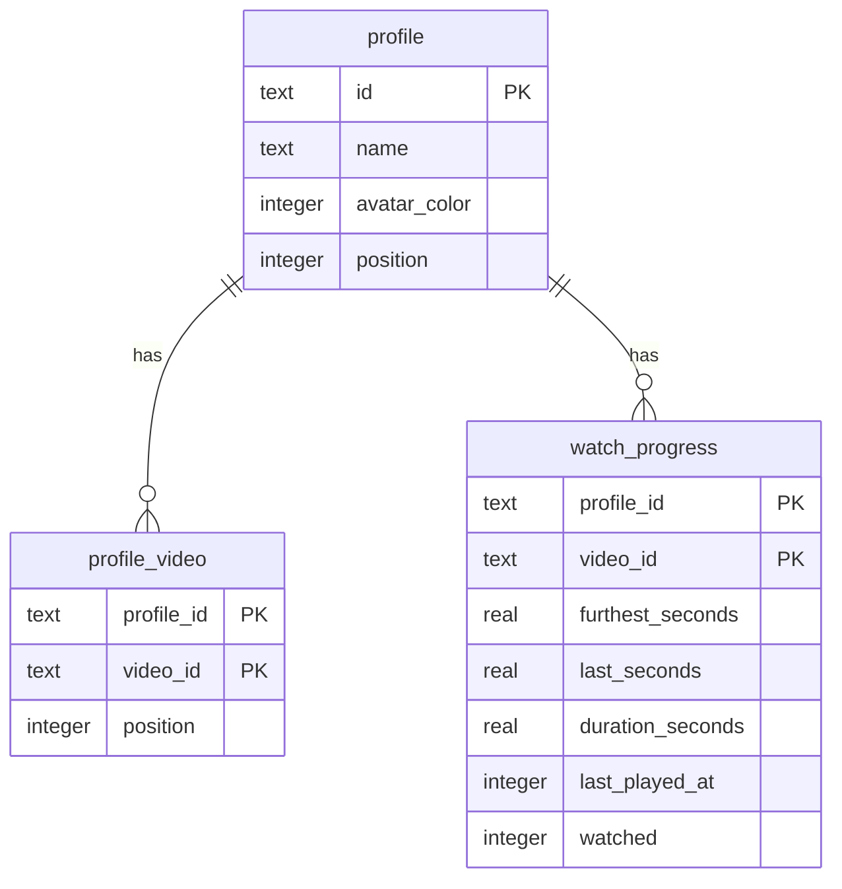

# Design: saving profiles, video lists, and progress

- **Date:** 2026-10-25
- **Status:** Accepted

## Intent

After [0002](../0002-library-home-player/spec.md), a child's progress lives only in
memory. When Android ends the app process (low memory, a force stop, a TV restart), every
green check, skill tab bar, "Keep watching" entry, and resume point is gone.

This spec makes the app remember. When a child comes back the next day, Home looks the
way they left it, and a half-finished video picks up where it stopped. Nothing new
appears on screen; the only visible change is that the app stops forgetting.

Profiles and each child's video list move into the same saved store now, even though
nothing can edit them until the setup wizard (spec 0004, next). The wizard then only writes to a store that already exists, and never touches the
plumbing.

## Goals

1. Watch progress (furthest point, last point, duration, last played time, watched)
   survives the app process ending, per child and per video.
2. Profiles survive the app process ending.
3. Each child's video list survives the app process ending.
4. On first launch, the store is filled with the two sample profiles, each given every
   video in the library, so the app behaves exactly as 0002 did.
5. A sudden power cut loses at most about 5 seconds of a playing video's progress.

## Non-goals

- Any change to the screens. Picker, Home, player, and Up next look and behave as in
  0002.
- Creating, editing, or deleting profiles, or changing a child's video list. That is the
  setup wizard, spec 0004.
- Backup, cloud sync, or sharing progress between TVs.
- A parent "reset progress" control. That belongs with parent settings.
- Schema migrations. Nothing is saved before this spec, so version 1 starts clean.
- Saving navigation state (which screen was open) beyond what Android already does.

## Anti-goals

- A screen that crashes or shows wrong data because it read the store before it loaded.
- Database work on the main thread.
- Progress that goes backwards: a saved watched check that reverts, or a furthest point
  that shrinks, after a restart.
- Hard-coding the sample profiles anywhere outside the seed data and tests.
- Reaching the 90% coverage floor by excluding the storage code.

## Constraints

- Everything in [AGENTS.md](../../../AGENTS.md) applies: test first, remote first, state
  in ViewModels, data through repository interfaces, writing style, no device details.
- The existing interfaces (`ProfileRepository`, `ProfileVideos`, `WatchHistory`) are the
  seams. Screens and ViewModels should need little or no change.
- `minSdk` 28, Robolectric at API 34, JDK 17 toolchain, AGP 9 with its built-in Kotlin.

## Decided by the owner

- Save watch progress, profiles, and each child's video list in this spec (profiles and
  lists seeded with the sample data, ready for 0004).
- No visible change to the screens.
- Out of scope: backup or sync, a reset control, screen changes.

## The how

Everything below is the designer's call; the builder may change it with a reason.

### Storage: Room

Recorded in [ADR-0007](../../adr/0007-room-for-saved-data.md). The app uses Room with
KSP, one database file (`dugout.db`), schema version 1, and the schema exported to
`app/schemas/` (tracked) so later specs can write tested migrations.

Room needs the KSP Gradle plugin. KSP's support for AGP 9's built-in Kotlin is the main
build risk, so the plan's first task proves the toolchain (Room compiles, a Robolectric
test opens an in-memory database, `just check` passes) before anything else is built. If
it cannot be made to work, stop and raise it with the owner rather than switching storage
silently.

### Tables

- `position` keeps display order (profiles on the picker, videos within a child's list).
- `video_id` refers to the bundled library, not to a table. The library stays bundled
  Kotlin code. A saved ID that is no longer in the library is ignored when read (Home
  already drops unknown IDs).
- Foreign keys from `profile_video` and `watch_progress` to `profile`, with cascade
  delete, so 0004 can remove a child cleanly.

### Loading before any screen

The current interfaces are synchronous: `profiles()` returns a list and
`progress(id).value` is read directly. Room reads are asynchronous. The design keeps the
interfaces and loads everything into memory once at startup (the data is tiny: a few
profiles, a few dozen videos each):

- A single `SavedStore` (name is the builder's call) opens the database on a background
  dispatcher, seeds it on first launch, and reads all three tables into memory.
- The saved implementations of `ProfileRepository`, `ProfileVideos`, and `WatchHistory`
  serve reads from that memory, exactly as the in-memory versions do now.
- The app shows only the plain `DugoutBackground` until the store reports loaded, then
  shows the `NavHost` (the plan gates this in `MainActivity`, so `DugoutApp` and
  `AppGraph` stay unchanged). This covers the case where Android restores the back stack
  straight to Home or the player after the process was killed.
- If the database cannot be opened or read, the app shows the background with a short
  message ("Something went wrong. Try restarting Dugout TV.") rather than crashing or
  starting empty. The builder may refine the wording.

### Writing

- `WatchHistory.record` and `markWatched` keep their current rules (furthest never
  shrinks, watched never reverts) and update memory at once, so screens are unchanged.
- Saving to the database is throttled: a video's progress is written at most every 5
  seconds while it plays, and immediately when the video ends (`markWatched`), when the
  child leaves the player (`onLeave`), and when the app goes to the background. The
  builder chooses the mechanism (a debounced writer, or the player ViewModel asking for a
  flush), as long as tests prove each of these cases.
- Writes run off the main thread in an application-wide scope, so leaving a screen does
  not cancel a pending save.
- A write that fails after a successful load (disk full, I/O error) is logged and
  otherwise ignored: memory keeps serving the screens, and the next write tries again.
  Screens do not change.

### Seeding

When the database file is first created (Room's `onCreate` callback, not "the `profile`
table is empty"), insert the sample profiles from `DEFAULT_PROFILES`, and give each one
every library video in library order. Seeding happens in one transaction. Later launches
never reseed, even if every profile has been deleted (0004 will allow that, and the
sample children must not come back).

A saved video list is the truth from then on. A video added to the bundled library in a
later release does not appear for existing children on its own; choosing videos is the
wizard's and parent settings' job, and 0004's larger library holds videos for other ages
that must not land on every child. This is a deliberate break from 0002, where every
child always saw the whole library.

The in-memory implementations stay for tests that do not need a database. The builder
decides whether `EveryVideoForEveryProfile` survives as a seed helper or goes away.

### Wiring

`DugoutApplication` owns the store, which builds the graph with the saved data once it
has loaded and exposes a `StateFlow` of load status. Tests keep building graphs with
in-memory parts and hand them straight to `DugoutApp`.

## Testing

- Unit tests under Robolectric against an in-memory Room database: seeding on first
  launch only, profiles and lists read back in order, progress round trip, the
  never-shrink and never-revert rules across a reopen, unknown video IDs ignored, and
  cascade delete.
- Throttling tests with a test dispatcher and fake clock: no write before 5 seconds, a
  write after, an immediate write on end, leave, and background.
- A Robolectric test that `DugoutApp` shows nothing focusable until loaded, then the
  picker with focus where it was before.
- A test for the error message when opening fails.
- Persistence across a restart: a test that records progress through one graph, closes
  it, builds a fresh graph on the same database file, and finds the progress on Home.
- Acceptance: the existing three tests keep passing. A new acceptance test does the
  restart check above on the emulator with a real file database, inside the test process
  (a fresh graph on the same file, not a real process kill; the real kill is the hand
  check below). `ProfilePickerAcceptanceTest` launches the real `MainActivity` and
  expects 0 watched, so every acceptance test starts by deleting the database file (or
  uses its own file name) to stay independent of run order.
- By hand on the owner's TV: watch part of a video and finish another, force stop the
  app, relaunch, and confirm the check, the tab bar, "Keep watching", and the resume
  point.

## Left to the builder

- Class and package names (a `storage/` or `data/` package is suggested).
- DAO shape, entity names, and whether progress rows hold a boolean or an integer.
- The exact throttle mechanism, within the rules above.
- Room and KSP versions (latest stable that works with AGP 9.4 and Kotlin 2.4).
- Whether to use the framework SQLite driver or the bundled one.

## Done when

- `just check` passes with coverage at or above 90% lines, with no new exclusions beyond
  Room's generated code.
- `just acceptance` passes, including the new restart test.
- The hand check on the TV passes.
- ADR-0007 is accepted and indexed, and AGENTS.md "What exists" no longer says saving is
  unbuilt.
