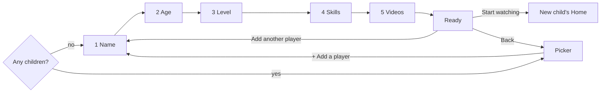
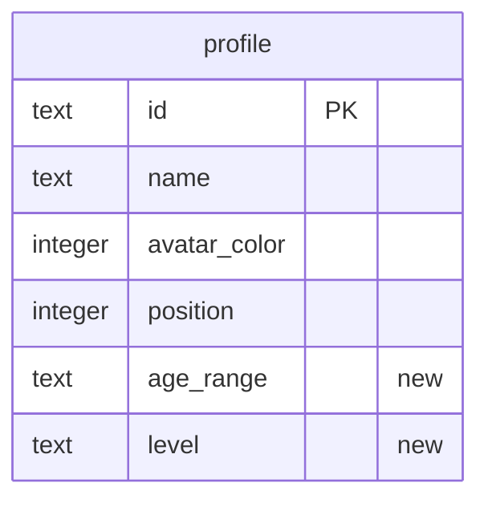

# Design: per-child setup wizard

- **Date:** 2026-10-25
- **Status:** Accepted

## Intent

Dugout TV is meant for any family, but today every install starts with two sample
children, Sam and Jack, who each get the whole 31-video library. A parent has no way to
add their own child or choose what that child watches.

This spec adds an "Add a player" wizard. A parent names the child, picks an age range
and a level of baseball, chooses the skills to work on, and picks videos for each skill.
Videos suited to that child's age and level start checked. The wizard runs straight away
on a fresh install, and the picker offers it afterward for each new child.

The data from [0003](../0003-saving/spec.md) already holds profiles and per-child video
lists. This spec writes to that store, adds age range and level to each child, and lets
the screens notice a newly added child.

## Goals

1. On a fresh install with no children, the app opens the wizard instead of the picker.
2. The picker shows a "+ Add a player" tile after the children, which opens the wizard.
3. The wizard collects, in five steps: name, age range, level, skills, and videos per
   skill. Every step works with the D-pad alone.
4. Recommended videos (matching the child's level and age) start checked on the video
   step. The parent can check or uncheck any video in a chosen skill.
5. Finishing saves the child (name, color, age range, level, video list) and offers
   "Start watching" (that child's Home) or "Add another player" (the wizard again).
6. Existing installs keep their children and all their progress through the upgrade.
7. The picker's "N watched" counts only videos on that child's list.

## Non-goals

- A larger library with tee-ball and coach-pitch videos. That is spec 0005 (a content
  search like 0002's, with the owner approving each video). Until then the wizard runs
  against the 31 kid-pitch videos as they are tagged today.
- The parent PIN. Anyone holding the remote can add a player until parent settings exist.
- Editing or deleting a child, or changing a child's videos after the wizard. That is
  parent settings, a later spec.
- My List.
- Choosing an avatar color or picture. The app assigns a color.
- Changing Home, the player, or Up next beyond what follows from per-child lists (Home
  already hides skills with no videos).

## Anti-goals

- Anything that nudges daily screen time: no streaks, goals, schedules, or reminders in
  the wizard. Pride comes from finishing skills, never from daily pressure.
- Assuming a fixed family: no names, number of children, or shared list baked into
  production code. Sam and Jack survive only in test data and in installs that already
  have them.
- Losing a child's progress in the database upgrade, or a destructive fallback (ADR-0007).
- A wizard step where focus is lost, lands somewhere unexpected, or cannot reach the
  button that moves on.
- Text drawn black on navy (tv-material `Text` outside a `Surface`; see AGENTS.md).

## Constraints

- Everything in [AGENTS.md](../../../AGENTS.md) applies: test first, remote first, state
  in ViewModels with stateless screens, data through repository interfaces, 90% line
  coverage, writing style, no device details.
- The schema change needs database version 2, an exported schema, and a tested migration
  from version 1 ([ADR-0007](../../adr/0007-room-for-saved-data.md)).
- Database work stays off the main thread.
- `minSdk` 28, Robolectric at API 34, JDK 17.

## Decided by the owner

- The wizard flow and screens as shown in
  [the wizard mockup](../../mockups/setup-wizard-mockup.html): picker tile, five steps
  (name, age, level, skills, videos) with a step label and progress dots, and a "ready"
  screen with "Start watching" and "Add another player". The mockup sets the layout of
  each screen; the text below sets the rules.
- The larger library is split out into spec 0005; 0004 uses today's tags.
- A fresh install starts with no children and opens the wizard. Existing installs keep
  their children.
- Each child's age range and level are saved. Existing children become "9 to 10, kid
  pitch".
- Recommendation rule, limits (name required, up to 12 characters, unique; at most 6
  children), Home tabs only for chosen skills, and the picker count fix, as played back.
- Out of scope: PIN, editing or deleting a child, changing videos later, My List.

## The how

The flow, screen content, and rules below were shown to and accepted by the owner.
Mechanisms (class names, navigation shape, how state is held) are the designer's
proposal; the builder may change them with a reason.

### Flow

Back on steps 2 to 5 returns to the previous step with its answers kept. Back on step 1
cancels without saving: it returns to the picker, or leaves the app when there are no
children yet (reopening the app starts the wizard again). Nothing is saved until the
parent presses Done on step 5.

### Picker

- A "+ Add a player" tile follows the children in the same row, with a dashed circle in
  place of an avatar. It takes focus like a child tile.
- Focus still starts on the first child. After the wizard, focus returns to the new child
  (Done, then Back) or to the "+" tile (cancelled).
- With 6 children the tile is hidden.
- "N watched" counts watched videos that are on the child's current list.
- The picker updates when a child is added, without restarting the app.

### Step 1: name

- A single text field, focused when the step opens, using the TV's own on-screen
  keyboard. The keyboard opens when the parent presses Select on the field, as Google TV
  does by default; it is not forced open (designer's call). A phone keyboard linked to the
  TV also works, with no work from this app.
- A "Next" button sits below the field. Back while the keyboard is open only closes the
  keyboard (platform behavior); Back with the keyboard closed cancels the wizard as
  described under Flow.
- The text is trimmed. It must be 1 to 12 characters and must not match another child's
  name, ignoring case. A short message under the field says what is wrong, and the step
  does not advance.
- The keyboard's Done or Next action, or the "Next" button, moves on.

### Step 2: age range

Five choices in a row: **4 to 6, 7 to 8, 9 to 10, 11 to 12, 13+**. Selecting one moves to
step 3 immediately. Focus starts on the previous answer, or on the first choice.

For matching against video tags, 13+ means 13 to 18.

### Step 3: level

Three choices, each with a one-line hint: **Tee ball** (hits off a tee), **Coach pitch**
(a coach throws), **Kid pitch** (kids pitch). Selecting one moves to step 4. Focus
starts on the previous answer, or else on the usual level for the age: tee ball for 4 to
6, coach pitch for 7 to 8, kid pitch for 9 and up.

### Step 4: skills

The five skills, in tab order, each a toggle, all on to start. Select toggles a skill. A
"Next" button follows them. At least one skill must stay on: turning off the last one is
refused with a short message.

### Step 5: videos

- Left column: the chosen skills, each with "N of M chosen". Right: the selected skill's
  videos from the library, in library order, each with a checkbox, title, length, and a
  "Recommended" badge where it applies.
- Moving focus onto a skill on the left shows its videos. Right moves into the list; Left
  returns to the skill. Select toggles a video.
- A "Done" button is reachable with Down from the bottom of the skill column (the
  builder places it so focus reaches it predictably and tests prove the path).
- **Recommended** means the video's levels include the child's level and its age range
  overlaps the child's. Recommended videos start checked; others start unchecked.
- When a skill has no recommended videos (any tee-ball or coach-pitch child today), the
  list shows all its videos unchecked with a note: "No videos picked for this level yet.
  Choose any you like."
- Every chosen skill needs at least one checked video. Done with an empty skill moves
  focus to that skill and shows a short message naming it.
- Answers on this step survive going back to earlier steps and returning, except that
  actually changing age or level resets the checks to the new recommendations, turning a
  skill off drops its videos, and turning it back on starts it again from its
  recommendations (designer's call).

### Ready screen

Shows the avatar, "<Name> is ready!", and "N skills, M videos". Focus starts on "Start
watching". Next to it, "Add another player" (hidden once there are 6 children). Back goes
to the picker with focus on the new child.

"Start watching" opens the child's Home with the picker beneath it on the back stack, so
Back from Home reaches the picker as usual. This holds on a fresh install too: the
picker is placed beneath Home even though the wizard was the first screen.

### Saving

- Pressing Done on step 5 saves the profile and its video list in one database
  transaction, off the main thread, then shows the ready screen. Memory and the picker
  update once the save succeeds.
- If the save fails, step 5 stays on screen with a message ("Couldn't save. Try again.")
  and Done can be pressed again. Nothing half-saved remains.
- The new child gets a random UUID as its ID, the next picker position, and the first
  color from a fixed palette of 6 that no other child uses (the palette is the builder's
  call, drawn from the existing theme and mockup colors, and includes the sample
  children's current colors so those are not handed out twice).
- The video list is saved in library order, grouped as the library orders it.

### Data changes

- Database version 2 adds `age_range` and `level` to `profile` (stored as enum names;
  the builder may choose another encoding).
- The migration from version 1 sets existing children to `9 to 10` and `KID_PITCH`,
  keeping every profile, list, and progress row. It is tested against the exported
  version 1 schema with real rows.
- New databases are created empty: no seeding in production. The seed mechanism stays
  available for tests.
- `Profile` gains the age range and level. The age ranges become an enum alongside
  `Level` in the library package (proposal).

### Making profiles and lists change at runtime

Today `ProfileRepository` and `ProfileVideos` are read once and never change, and the
picker reads its profile list once. The design proposal:

- The profile repository exposes the profiles as a `StateFlow`, and gains a suspend
  `add` (profile plus video IDs) that writes through to the database and then updates
  memory. `ProfileVideos` reads from the same updated memory.
- The in-memory implementation supports `add` too, so ViewModel and screen tests need no
  database.
- The picker ViewModel collects the flow, so a new child appears and its watched count
  is tracked.

The builder may shape this differently (for example a separate writer interface), as
long as screens take state and callbacks and tests can substitute the data source.

### Navigation

- Proposal: a `setup` route holding one wizard ViewModel for all five steps and the ready
  screen, with the step as part of its UI state and Back handled inside it. One route
  keeps answers when stepping back and avoids passing them between destinations.
- Launch chooses the start screen from the loaded profiles, so the picker never flashes
  before the wizard on a fresh install.
- Every navigation action is guarded like the picker's (act only while that screen is
  current) so a fast double press cannot open two wizards or two Homes.

## Testing

- **ViewModel tests** for the wizard: name rules (trim, empty, too long, duplicate
  ignoring case); age and level defaults; at-least-one-skill rule; recommendation rule
  including the no-match case; checks reset when age or level changes; empty-skill check
  on Done; save success and failure; color and position assignment; the 6-child limit.
- **Robolectric screen tests** for each step: where focus starts, how it moves (left and
  right in the video step, down to Done), Back between steps keeping answers, and Back on
  step 1 cancelling.
- **Picker tests**: the "+" tile, focus return after cancel and after adding, the tile
  hidden at 6 children, the new child appearing, and the count fix.
- **App tests**: a fresh store with no children opens the wizard; finishing it and
  choosing "Start watching" shows the new child's Home with only the chosen skills.
- **Storage tests**: the version 1 to 2 migration with real rows (Room's
  `MigrationTestHelper`), adding a profile with its list in one transaction, a failed add
  leaving nothing behind, and a new database starting empty.
- **Acceptance** (emulator, real D-pad): a new test adds a child through the wizard from
  a fresh database (typing the name with key events), starts watching, and checks Home.
  Existing acceptance tests that expect Sam and Jack seed them explicitly, through their
  own database file as `SavedDataAcceptanceTest` already does.
- **By hand on the owner's TV:** install over the 0003 build and confirm Sam and Jack
  keep their progress; add a child with the TV keyboard; check the new child's Home.

## Follow-ups (not in this spec)

- **0005 larger library:** tee-ball and coach-pitch videos, and ages 4 to 8 and 13+, so
  recommendations work for every child.
- **Parent settings:** PIN, edit or delete a child, change their videos.
- The full-screen player, as recorded separately.

## Left to the builder

- Class, package, and route names.
- The avatar palette, within the theme.
- Exact message wording, within the writing style.
- How `ProfileRepository` and `ProfileVideos` become changeable, within the rules above.
