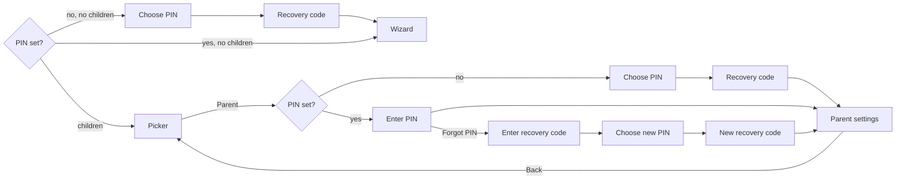
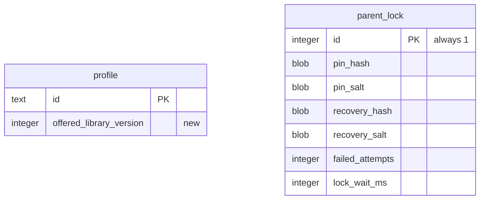

# Design: parent settings and PIN

- **Date:** 2026-10-25
- **Status:** Draft

## Intent

After [0004](../0004-setup-wizard/spec.md) a parent can add a child, but nothing about that
child can change afterward. The picker's "Parent" button opens a placeholder, and any
child holding the remote can start the setup wizard.

This spec puts parent settings behind a 4-digit PIN. Inside, a parent can see each
child's progress, edit their profile, change their video list, reset progress, remove the
child, add a player, and change the PIN. It also fixes a known gap: video lists are frozen
at setup, so the 16 videos added in [0005](../0005-more-videos/spec.md) never reach
existing children. The video editor marks them "New" so a parent can add them.

## Goals

1. A 4-digit parent PIN guards parent settings and adding a player. It is chosen once,
   can be changed, and can be reset with a recovery code shown when it is chosen.
2. Parent settings show every child, and for each child: progress, profile, videos, and
   remove.
3. A parent can edit a child's name, age range, and level.
4. A parent can add or remove any library video on a child's list, including skills the
   wizard skipped, with videos the child has not been offered before marked "New".
5. A parent can reset progress for one video or one skill.
6. A parent can remove a child.
7. The PIN and recovery code are never stored in a readable or easily reversible form.
8. Existing installs keep every child, list, and progress row through the upgrade.

## Non-goals

- A per-video "stop at" time. It changes the player and is a later spec.
- Daily time limits or schedules. Google TV has its own controls, and they cut against
  the product's "no daily pressure" stance.
- My List, the full-screen player, and videos for other ages and levels.
- Reordering videos within a list. Lists stay in library order.
- Choosing an avatar color.
- Recovering the PIN through a phone, email, or server. The app has no account or server.

## Anti-goals

- Anything a child can get past with a remote and patience: a math question, a waiting
  period, or an unlimited number of PIN guesses.
- A single stray button press erasing a child or their progress.
- Storing the PIN or recovery code in plain text, or encrypted in a way the app could
  decrypt.
- Progress shown as screen time, daily totals, or charts. The parent view shows what is
  finished, not how long anyone watched.
- Losing children's progress in the database upgrade, or a destructive fallback
  ([ADR-0007](../../adr/0007-room-for-saved-data.md)).
- Focus lost, trapped, or landing somewhere unexpected anywhere in parent settings.

## Constraints

- Everything in [AGENTS.md](../../../AGENTS.md) applies: test first, remote first, state
  in ViewModels with stateless screens, data through repository interfaces, 90% line
  coverage, writing style, no device details.
- The schema change needs database version 3, an exported schema, and a tested migration
  from version 2. Database work stays off the main thread.
- `minSdk` 28, Robolectric at API 34, JDK 17. Robolectric has no Android Keystore, so
  the Keystore-backed code sits behind an interface that tests replace.
- Names in mockups and tests are placeholders; never the owner's children.

## Decided by the owner

- Scope: edit profile, change videos, see progress, plus the PIN with change and
  recovery, remove a child, "Add a player" moved behind the PIN, "New" marks for videos
  added to the library, and reset progress. "Stop at" and time limits are out.
- Recovery is a one-time code shown when the PIN is chosen. A harder puzzle was
  rejected because children can do math. If the code is lost too, the last resort is
  clearing the app's data in the TV's settings, and the app says so.
- Change PIN and Forgot PIN flows, 4 digits on an on-screen pad, and the lockout after 5
  wrong tries, as played back.
- The PIN is stored as a salted slow hash mixed with a key held in the Android Keystore,
  not encrypted. The recovery code is stored the same way.
- Layout A, two panes: children down the left, the selected child's pages on the right
  ([the mockup](../../mockups/parent-settings-mockup.html)).
- The Profile, Videos, Progress, and Remove panes and their rules, as shown in the mockup.
- A fresh install asks for the PIN before the wizard. An existing install without a PIN
  asks for one the first time Parent is opened; until then the picker keeps its "Add a
  player" tile.

## The how

The flow, screen content, and rules below were shown to and accepted by the owner.
Mechanisms (class names, storage shape, navigation) are the designer's proposal; the
builder may change them with a reason.

### Flow

- Back from parent settings returns to the picker with focus on the Parent button. The
  next visit asks for the PIN again; nothing stays unlocked.
- Back on any PIN screen returns to where it came from without changing anything. On a
  fresh install, Back on "Choose PIN" leaves the app (as Back on the wizard's first step
  does today), and reopening starts at "Choose PIN" again.

### PIN entry screen

- Title ("Enter parent PIN", "Choose a parent PIN", "Enter it again", "Enter current
  PIN"), four dots that fill as digits are entered, and a 3 by 4 number pad: 1 to 9, then
  delete, 0, and OK. Focus starts on 5, the middle key.
- The phone-style number keys on a remote also enter digits, where the remote has them
  (designer's call).
- OK is accepted only with four digits. When the fourth digit is entered the PIN is
  checked straight away (designer's call), so OK is rarely needed.
- A wrong PIN clears the dots and shows "Wrong PIN".
- "Forgot PIN" sits below the pad, reachable with Down from the bottom row. It shows
  only when entering an existing PIN.
- Choosing a PIN asks twice. If the two differ, it says so and starts again.

### Lockout

- 5 wrong attempts in a row (PIN or recovery code, one shared count) lock both screens
  for 1 minute. Each further run of 5 doubles the wait, up to 1 hour (cap is designer's
  call). A correct entry resets the count.
- While locked the screen shows "Try again in N minutes" and the pad does not accept
  digits. Back still works.
- The count and the length of the current wait are saved, so closing or restarting the
  app does not reset them. The wait is counted down with the device's monotonic clock
  (time since boot), never the wall clock, so changing the TV's date or time cannot skip
  it. The deadline is saved with the TV's boot count: after an app restart in the same boot
  the wait resumes where it was (so a wait that has run out stays over), and after a reboot
  a wait still in force starts again at its full length (designer's call, revised after the
  final review: it needs no wall clock).

### Recovery code

- 8 characters shown as `XXXX-XXXX`, drawn at random from digits and capital letters
  without look-alikes (no 0, O, 1, I, L), using a secure random source.
- Shown on its own screen after a PIN is chosen: "Write this down or take a photo. You
  need it if you forget the PIN." Focus starts on "I've saved it", which continues.
- Entering it uses a text field with the TV's on-screen keyboard. Case, spaces, and the
  dash are ignored.
- A correct code leads to choosing a new PIN, then a new code. Every new code replaces
  the old one.
- A new PIN and its code are saved together, in one write, only when the parent presses
  "I've saved it". Until then the old PIN and code stay in force. Back on the code screen
  discards the pending PIN and returns to the start of that flow (Choose PIN, Change
  PIN's current-PIN step, or the recovery code field). On a fresh install that means
  Choose PIN, whose Back leaves the app (designer's call).
- The Forgot PIN screen also says: "Lost the code too? Clearing Dugout TV's data in the
  TV's settings removes the PIN, but it also erases every player and all progress."

### Storing the PIN

- The PIN and the recovery code are each stored as PBKDF2 (HMAC-SHA256) over the input
  with a random 16-byte salt, then passed through HMAC-SHA256 with a key generated in and
  never leaving the Android Keystore. Only the result and the salt are saved. The
  iteration count is the builder's call, aiming for roughly 100 to 300 ms per check on a
  TV.
- Comparisons use a constant-time equality check.
- This sits behind an interface (proposal: `PinHasher`) so tests use a plain fake. The
  real class is small; it is exercised in the emulator acceptance suite, which has a real
  Keystore.
- Both hashes depend on the Keystore key, so a lost key means neither the PIN nor the
  code can be checked. This should not happen (clearing app data removes the key and the
  database together). If it does while a PIN exists, the PIN screen says the lock can't
  be opened and gives the same "clear Dugout TV's data" advice as the Forgot PIN screen
  (designer's call: weakening the recovery hash to survive this was rejected, since the
  owner asked for the PIN data to be secure).

### Parent settings layout

- **Left pane:** each child (avatar and name) in picker order, then "+ Add a player"
  (hidden at 6 children), then "Change PIN". Focus starts on the first child.
- **Right pane:** for the child focused on the left, a row of tabs (Progress, Profile,
  Videos, Remove) and the selected tab's content. Moving focus to another child shows
  that child with the Progress tab.
- Right from the left pane moves into the tab row. Down from a tab moves into its
  content. Left from the first item of a row returns to the tab row or the left pane, and
  Back from inside the right pane returns focus to the child on the left. Back from the
  left pane leaves parent settings.
- After any change, focus stays on the item that was changed.
- With no children (they were all removed), see Remove below.

### Progress tab

- Skill chips for the child's skills, each "N of M" (finished out of on the list), in
  tab order. Below, the selected skill's videos from the child's list, each with its
  state (Finished, Watched N%, or Not started, using the existing watched and started
  rules) and the date it was last played (none when not started).
- Selecting a video with progress opens "Reset <title>?" with Cancel (focused) and Reset.
- The last row of each skill is "Reset all <skill> progress", which confirms the same way.
  It clears progress on every library video in that skill, including unchecked ones, so
  checking a video again later never brings back progress the parent reset (designer's
  call).
- Reset deletes the progress rows, so the child starts those videos from the beginning
  and their Home counts update.

### Profile tab

- Three rows: Name, Age range, Level, each with its current value.
- Selecting a row opens the same choice the wizard uses (name field with its rules, the
  five age ranges, the three levels). Confirming saves straight away; Back cancels.
- Name follows the wizard's rules: trimmed, 1 to 12 characters, unique ignoring case.
- Changing age range or level only changes which videos are marked Recommended on the
  Videos tab. It never adds or removes videos.

### Videos tab

- Skill chips for all five skills (every skill with videos in the library), each with
  "N chosen" and, when it applies, "N new". Below, the selected skill's library videos in
  library order, each with a checkbox, title, length, and "Recommended" and "New" badges.
- Select toggles a video, and the change saves straight away (designer's call: no Save
  button, like the TV's own settings).
- Unchecking keeps the child's progress for that video. Checking it again brings the
  progress back. A skill with no checked videos disappears from the child's Home, as
  today.
- The last checked video on the whole list cannot be unchecked; a short message says a
  player needs at least one video.
- **New** marks a library video the child has never been offered. Proposal: each
  library video carries the library version it arrived in (the original 31 are version
  1, the 0005 additions version 2), and each child stores the newest version they have
  been offered. A video is New when its version is greater. Opening the child's Videos
  tab and then leaving it raises the child's offered version to the current one, so the
  marks clear once a parent has seen them (designer's call). Children created by the
  wizard start at the current version.

### Remove tab

- "Remove <name>?" with the warning that the profile, video list, and all progress are
  deleted and cannot be restored. Buttons "Keep <name>" (focused when the tab opens) and
  "Remove <name>".
- Removing deletes the child and everything of theirs in one transaction, renumbers
  picker positions, and moves focus to the next child on the left (or the previous one if
  it was last).
- Removing the last child leaves parent settings and opens the wizard, as on a fresh
  install. The PIN stays.

### Add a player and Change PIN

- "+ Add a player" opens the existing wizard. Back on its first step returns to parent
  settings. After Done, the ready screen's Back returns to parent settings with the new
  child selected; "Start watching" goes to the child's Home with the picker beneath it,
  as today.
- Once a PIN exists, the picker no longer shows the "+ Add a player" tile.
- "Change PIN" asks for the current PIN (with the lockout), then the new one twice, then
  shows a new recovery code, and returns to parent settings with focus on Change PIN.

### Data changes

- Database version 3 adds `profile.offered_library_version` and a single-row
  `parent_lock` table. No row means no PIN has been set.
- The migration from version 2 sets `offered_library_version` to 1 for existing children,
  so the 0005 videos show as New for them. Every profile, list, and progress row is kept.
  It is tested against the exported version 2 schema with real rows.
- `Video` gains its library version (proposal: `addedIn`).
- `ProfileRepository` gains update and remove; `WatchHistory` gains reset for one video
  and for a set of videos, which also drops any unsaved progress for them in
  `ProgressWriter` so a pending write cannot bring it back. The in-memory versions
  support all of it for tests.
- A new repository interface for the lock (proposal: `ParentLock`) covers: is a PIN set,
  prepare a new PIN (returns a pending PIN and code, saving nothing), commit a pending
  PIN, check PIN, check recovery code, and the lockout state.

### Navigation

- Proposal: a `parent` route group: the PIN gate, recovery, and settings, with Change PIN
  and Add a player opened from settings. The wizard route gains a way to know it was
  opened from parent settings, so Back returns there.
- Startup chooses the first screen from whether a PIN exists and whether there are
  children, so nothing flashes first.
- Every navigation action is guarded as today against double presses.

## Testing

- **Lock tests:** PIN set and check, recovery code format and check (case, dash, spaces
  ignored), a new code replacing the old, nothing saved before commit, the lockout
  schedule and cap, lockout surviving a restart, a wall-clock change not shortening it,
  and a correct entry clearing the count. Use a fake monotonic clock and a fake hasher.
- **Hasher tests** (acceptance suite, real Keystore): the same input and salt give the
  same result, different salts differ, and the stored data does not contain the PIN.
- **ViewModel tests** for the PIN screens, parent settings, and each tab: name rules, the
  last-video rule, New marks and clearing them, reset, remove including the last child.
- **Robolectric screen tests:** focus start and movement on the pad, the two panes, each
  tab, and each confirmation (safe button focused first); Back at every level.
- **Picker and startup tests:** fresh install opens Choose PIN then the wizard; the "+"
  tile shows without a PIN and hides with one; Parent leads to Choose or Enter PIN.
- **Storage tests:** the version 2 to 3 migration with real rows, remove cascading in one
  transaction, and reset leaving other progress alone.
- **Acceptance** (emulator, real D-pad): choose a PIN on a fresh install and add a child;
  from the picker enter the PIN, uncheck and check a video, reset its progress, and
  remove a child; wrong PIN shows the message. Existing tests that use the picker's "+"
  tile set up their state so the tile is still shown, or go through parent settings.
- **By hand on the owner's TV:** install over the 0005 build, confirm the children and
  progress survive, choose a PIN, see the 0005 videos marked New, add some, and confirm
  they appear on the child's Home.

## Follow-ups (not in this spec)

- Per-video "stop at" time.
- My List.
- The full-screen player, as recorded separately.
- Videos for tee ball, coach pitch, and 13+.

## Left to the builder

- Class, package, and route names.
- Exact wording, within the writing style.
- The PBKDF2 iteration count, within the time target.
- How the tab row and lists are built, as long as focus behaves as described and tests
  prove it.
