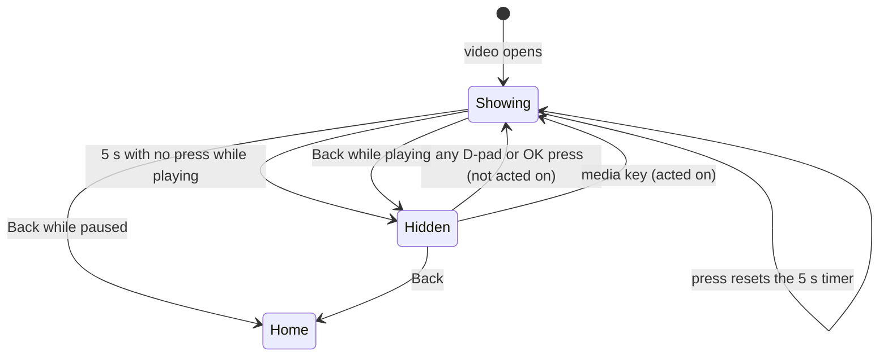

# Design: full-screen player

- **Date:** 2026-10-25
- **Status:** Draft

## Intent

The player from [0002](../0002-library-home-player/spec.md) shows the video at about two
thirds of the screen width, with the title, progress bar, and Pause, Back 10s, and
Slow-mo buttons below it. On a TV across the room the video is smaller than it needs to
be, and the controls are plain text buttons sized for adults.

This spec makes the video fill the TV and replaces the controls with large baseball
buttons that fade in over the bottom of the video and fade out again, the way children
already know from other TV video apps. It drops Back 10s and adds Start over, an instant
Replay in slow motion, a progress bar a child can move along to go forward or back, the
remote's media keys, a baseball loading spinner, and keeping the TV awake during
playback.

Drawing over the YouTube player breaks YouTube's embedded player policy. The owner chose
to accept that while the app is unpublished;
[ADR-0008](../../adr/0008-controls-over-the-player-while-unpublished.md) records it.

## Goals

1. The video fills the whole screen while it plays, with nothing drawn over it when the
   controls are hidden.
2. The controls appear on any remote press and hide again after about 5 seconds without
   a press while playing. They stay up while paused.
3. A child can reach every control with at most two presses from Pause.
4. A child can move forward and back through a video quickly from the progress bar.
5. Replay shows the last few seconds again in slow motion with a single press.
6. The TV's screensaver does not start while a video plays.
7. Existing behavior carries over: resume from saved progress, saving progress, watched
   at 90%, the Up next screen on end, the error screen, and Back to Home with focus on
   the video.

## Non-goals

- Mirroring the video for left-handed children, looping a clip, and quarter speed. Each
  was discussed and left for a later spec.
- A per-video "stop at" time (a later spec), My List, and a "Next video" button (Up next
  covers the end of a video).
- Skipping forward with a button. Moving forward is through the progress bar and the
  remote's fast-forward key only.
- Changing what "watched" means. A child who moves the progress bar past 90% gets the
  video counted as watched; the owner accepted this.
- Volume, captions, and quality controls.

## Anti-goals

- A single stray press doing something the child did not mean: pausing, seeking, or
  leaving the video while the controls are hidden.
- Remote focus entering the YouTube WebView, being lost, or landing somewhere invisible.
- Losing progress or watched state that works today.
- Celebrations, streaks, or watch-time counters in the player.

## Constraints

- Everything in [AGENTS.md](../../../AGENTS.md) applies: test first, remote first, state
  in ViewModels with stateless screens, 90% line coverage, writing style, no device
  details.
- [ADR-0006](../../adr/0006-youtube-embedded-player.md) stands except for the no-overlay
  rule, which [ADR-0008](../../adr/0008-controls-over-the-player-while-unpublished.md)
  replaces. Player options, blocked WebView focus, and unloaded captions stay as they
  are.
- The YouTube player needs a WebView, which Robolectric cannot run. Behavior is tested
  through `FakePlayerSurface` and `FakeVideoPlayer`; the real look is checked on the
  owner's TV.
- YouTube shows its own title strip, center icon, and "More videos" bar at the start of a
  video and after a seek. The app cannot hide them, and they may briefly sit under the
  app's controls.
- Video titles and frames in mockups and tests are placeholders; never the owner's
  children.

## Decided by the owner

- The video fills the screen, and the app's controls draw over its bottom edge, accepting
  the policy risk while unpublished (spike on the owner's TV confirmed the overlay
  draws).
- Layout C from the brainstorm: centred round buttons drawn as baseballs with red
  stitches, the focused one glowing gold and slightly larger, Pause the large middle one
  ([the mockup](../../mockups/player-mockup.html)).
- The buttons are Start over, Pause/Play, Replay, and Slow-mo, in that order. Back 10s is
  removed.
- Slow-mo uses a turtle icon.
- Moving forward and back is done on the progress bar: Up from the buttons selects it,
  Left and Right jump 10 seconds, holding speeds up, and a bubble shows where the child
  will land (mockup panel 3).
- The remote's play/pause, rewind, and fast-forward keys work directly.
- Added from the extras list: a baseball loading spinner, and keeping the TV awake while
  a video plays.
- Skipping past 90% counts the video as watched; no change to that rule.

## The how

The behavior and look below were shown to and accepted by the owner, except where marked
as the designer's call. Mechanisms (class names, where state lives) are the designer's
proposal; the builder may change them with a reason.

### Layout

- The video surface fills the screen edge to edge on a black background. The app's
  `DugoutBackground` padding no longer applies to the video.
- When the controls show, a dark fade rises from the bottom (clear at about 45% of the
  screen height, near-black at the bottom, using the app's navy), and over it, from top
  to bottom: the title with its channel badge, the progress bar with the time
  ("0:34 / 2:36") at its right, and the row of four baseball buttons centred, each with a
  short label below it.
- The buttons: Start over (a skip-to-start icon), Pause or Play (second in the row and
  larger than the others), Replay (a circular back arrow), and Slow-mo
  (a turtle). Labels: "Start over", "Pause" or "Play", "Replay", "Slow-mo" or "Normal
  speed" while slow motion is on.
- A baseball is drawn as a chalk circle with two curved red stitch lines. The focused
  ball gets a gold ring and glow and scales up by about 10%. Icons are drawn in navy on
  the ball.
- The progress bar is thicker than today's (about 8 dp), red fill on a pale track, with a
  small baseball as its marker.
- "Slow-mo isn't available for this video" shows as a short line under the button row
  when YouTube refuses half speed, as today.
- Fade in and out take about 200 ms (designer's call).

### When the controls show and hide

- A video opens with the controls showing and focus on Pause, so a child sees they
  exist. They hide after 5 seconds without a press once the video is playing.
- While hidden, any D-pad direction or OK shows the controls with focus on Pause and does
  nothing else. The press that woke them is not passed on.
- Every press while the controls show restarts the 5-second timer, including presses on
  the progress bar.
- While the video is paused, still loading for the first time, or showing the slow-mo
  unavailable message, the controls stay up (designer's call for loading and the
  message). The timer starts again once it is playing. Buffering after the video has
  played once (after a seek or a network stall) neither keeps the controls up nor brings
  them back (designer's call), so they never sit over YouTube's own buffering spinner
  for long.
- Back while the controls show and the video is playing hides them. Back while hidden, or
  while paused, leaves to Home with focus on the video, as today, saving progress first.
  (Designer's call: one Back that both hides and leaves felt abrupt, and a paused screen
  has nothing to hide to.)
- On the error screen there are no controls; it keeps its message and focused Back
  button, centred on black.

### Buttons

- **Pause/Play:** as today.
- **Start over:** seeks to 0 and plays. Slow-mo stays as it was.
- **Replay:** seeks back 5 seconds (not before 0) from the current position, switches to
  half speed, and plays. When the position reaches the point where Replay was pressed,
  it returns to normal speed. If Slow-mo was already on, Replay only seeks back and
  leaves the speed alone. If YouTube refuses half speed, Replay still seeks back and plays
  at normal speed, and the unavailable message shows as it does for Slow-mo. Pressing
  Replay again during a replay starts a new one from the new position, keeping the
  original return point (designer's call). Pressing Slow-mo during a replay ends the
  replay: the speed becomes whatever Slow-mo now says.
- **Ending a replay (designer's call):** besides reaching the return point and pressing
  Slow-mo, any other seek ends a replay: Start over, a progress bar move when it seeks,
  and rewind or fast-forward. The speed goes back to the child's Slow-mo setting. Pause
  does not end a replay; Play continues it.
- **The Slow-mo label during a replay (designer's call):** the button always shows the
  child's own Slow-mo choice, not the speed YouTube is playing at. A replay's half speed
  never makes it read "Normal speed". This needs the state to keep the child's choice
  apart from the rate YouTube last confirmed.
- **Slow-mo:** as today, a toggle between half and normal speed, shown as on only after
  YouTube confirms.

### Progress bar

- Up from any button selects the progress bar. Its marker grows and glows gold, the bar
  thickens slightly, and the button row dims.
- Left and Right move the marker 10 seconds back or forward. Holding a direction repeats,
  and after about 1 second of holding each step becomes 30 seconds (designer's call on
  the exact timing).
- A gold bubble above the marker shows the target time and the change from where the
  move started ("1:14 +40s", "0:12 -20s").
- The marker moves at once; the video seeks to the target when the child stops pressing
  for about 0.5 seconds (designer's call, so YouTube is not asked to seek on every step).
  While a move is pending, position updates from the player do not move the marker.
- The target is held between 0 and 1 second before the end, so moving the bar never jumps
  straight to Up next (designer's call).
- Down or OK on the bar returns focus to Pause, after seeking at once if a move is
  pending. Back follows the hide rules above, applying any pending move first.

### Remote media keys

- Play/pause, play, and pause keys act on the video directly, whether the controls show
  or not, and show the controls.
- Rewind and fast-forward work exactly like Left and Right on the progress bar (designer's
  call): they show the controls with the bar selected, move the marker 10 seconds (30
  when held), show the bubble with the change adding up across presses, and seek after
  the same 0.5-second pause.
- Other media keys (next, previous, stop) are ignored (designer's call).

### Loading spinner

- Until the video first reports playing, a baseball (the same drawing as the buttons,
  larger) spins in the centre of the screen over the black video area. It disappears for
  good at the first `PLAYING`.
- Buffering later in the video shows YouTube's own spinner only, so two spinners never
  show at once (designer's call; the builder checks on the TV that YouTube shows one).
- The start timeout and error screen from 0002 are unchanged.

### Keeping the TV awake

- While the video is playing, the player keeps the screen on (for example
  `View.keepScreenOn` on the player's view). When it is paused, has ended, has failed, or
  the child leaves, the flag is cleared so the TV's screensaver can run as normal.
- Checked on the TV: a video played longer than the TV's screensaver delay keeps playing
  with no screensaver.

### State (designer's proposal)

- `PlayerUiState` gains `controlsVisible`, the progress bar's pending target (or none),
  `replaying`, and whether the video has played once. `slowMo` means the child's
  confirmed choice; a rate confirmation that belongs to a replay does not change it. `PlayerViewModel` owns the 5-second hide timer, the replay return
  point, and the debounced seek, using `viewModelScope` with delays so tests can drive
  them with a test dispatcher.
- `onBackTenSeconds` is removed. New ViewModel calls: `onStartOver`, `onReplay`,
  `onScrub(direction, held)`, `onScrubCommit`, `onWake`, `onHideRequested`, and media key
  handlers. The screen stays stateless apart from focus requesters and key handling.
- `VideoPlayer` keeps its methods; Replay uses `seekTo`, `requestSlowMo`, and `play`.

### Documentation

- AGENTS.md: replace the gotcha "Nothing may be drawn over the YouTube player..." with
  the ADR-0008 rule (app controls may draw over the player while unpublished; remote
  focus stays out of it).
- `docs/architecture/app-structure.md`: update the player's focus line and anything that
  says controls sit below the video.

## Testing

- **ViewModel tests:** hide after 5 s while playing; no hide while paused or loading;
  every press restarts the timer; Start over seeks to 0 and plays; Replay seeks back 5 s
  (and to 0 near the start), requests half speed, and returns to normal at the press
  point; Replay with Slow-mo on only seeks; Replay when half speed is refused; scrub steps
  of 10 s and 30 s when held, clamped at both ends, one seek after the pause; media keys;
  the keep-awake flag follows the playing state.
- **Robolectric screen tests:** focus starts on Pause; Left reaches Start over, Right
  reaches Replay then Slow-mo, and Up reaches the bar from each; Down from the bar returns
  to Pause; the first press while hidden only shows the controls; Back hides then leaves;
  Back while paused leaves; the bubble text; the spinner until first playing; the error
  screen; slow-mo and unavailable labels.
- **Acceptance (emulator, real key events):** extend `HomePlayerAcceptanceTest`: open a
  video, wait for the controls to hide, press a direction and see them return without
  pausing, use Replay and the bar, Back to Home with focus on the video.
- **On the owner's TV (builder runs, with screenshots):** full screen with no app drawing
  when hidden; controls readable over a bright video; the bar moves and the video seeks;
  Replay plays slowly then speeds up; YouTube's buffering spinner and ours never both
  show; no screensaver during a long video.

## Left to the builder

- Exact sizes, spacing, icon drawing, and animation curves, matching the mockup.
- How key events are intercepted (for example `onPreviewKeyEvent` on the screen root) so
  the waking press is consumed and media keys reach the ViewModel.
- Whether the hide timer and scrub debounce live in the ViewModel or a small helper it
  owns.
