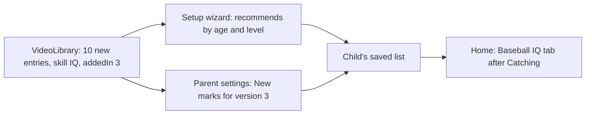

# Design: Baseball IQ videos

- **Date:** 2026-10-25
- **Status:** Accepted

## Intent

Every video in the library teaches a body skill: how to swing, field, run, pitch, or
catch. Nothing teaches a child how to think in a game: where the out is, when to tag up,
who the cutoff is. The owner wants to build that "baseball IQ" for two children, one
about 8 to 9 and one about 10 to 11.

This spec adds a sixth skill tab, Baseball IQ, holding explainer videos in two tiers:
basics for younger children and game situations for older ones. It is the first of two
steps. The second, a later spec, is a "What's the Play?" game in which a child reads a
field diagram and answers with the D-pad. This spec comes first because it reuses the
existing library, so it is cheap and shows whether the children take to the topic.

Books such as *Baseball IQ Playbook for Kids* (Warren) and *Baseball iQ for Kids and
Teens* (Collis and Blank) shaped which topics to cover. Nothing from them is copied into
the app.

## Goals

1. Home shows a Baseball IQ tab, after Catching, for any child whose list has an IQ
   video. Existing tabs keep their order, and Hitting stays first.
2. Basics videos (force outs, tag outs, tagging up) are tagged ages 7 to
   12, coach pitch and kid pitch, so the setup wizard recommends them to both children.
3. Game situation videos (cutoffs and relays, backing up, rundowns, the infield
   fly) are tagged ages 10 to 12, kid pitch.
4. The new videos carry library version 3, so parent settings marks them New for
   children who already exist and a parent can add them there.
5. The setup wizard offers Baseball IQ as a skill alongside the other five, and the
   skill row and the home tabs still fit a TV screen with six entries.

## Non-goals

- The "What's the Play?" game, field diagrams, or anything drawn by the app. That is a
  later spec.
- Body-skill videos for coach pitch. A coach pitch child set up today is recommended only
  the IQ basics; the 0004 follow-up for other ages and levels stays open.
- Adding IQ videos to existing children without a parent. Saved lists stay frozen (0003).
- Any change to the database or schema. Skills are not stored; each video names its own.

## The videos

All were checked on 2026-10-25 to be embeddable, marked family safe, and under 15
minutes. Lengths are in seconds. The owner asked the builder to choose; the choice
favors videos that talk to children rather than to coaches.

### Basics (ages 7 to 12, coach pitch and kid pitch)

| YouTube ID | Title | Channel | Length |
|---|---|---|---|
| -3cUVRvwUiU | Force Out vs. Tag Out | D-BAT | 152 |
| ZZgrq4iJi9I | Force Outs | TheOnDeckCircle | 312 |
| _SZhK8baRA4 | How Tagging Up Works | Be Well Played | 74 |
| HdLIgsH1ZP0 | Why Not to Run on a Pop Fly | Ball Basics | 115 |
| vjoIcUIgv5o | Tagging Up and Sacrifice Flies | TheOnDeckCircle | 213 |

### Game situations (ages 10 to 12, kid pitch)

| YouTube ID | Title | Channel | Length |
|---|---|---|---|
| LD4H96mlpr8 | Backing Up Bases | Antonelli Baseball | 353 |
| wIU9NdCBBkE | Cutoffs and Relays | ELITE YOUTH BASEBALL | 646 |
| ON07qcMZuhg | Who Is the Cutoff? | Antonelli Baseball | 377 |
| OAbBekHAk_g | Rundowns | Antonelli Baseball | 344 |
| iphFBx_Ejk4 | The Infield Fly Rule | MLB Clubhouse | 218 |

The order within each table is the display order: basics first, then situations, each
running from simplest to hardest. The tab's first video is a short one made for
children. The library grows from 47 to 57 videos, and the IQ skill has 10.

### Considered and left out

| YouTube ID | Title | Why not |
|---|---|---|
| 7v7RHPZFu0k | What Are Baseball Situations? | Promotes a coaching workshop; 11 minutes |
| Z5d6zbJOv3M | 1st and 3rd Defense | Addressed to coaches running a team |
| iABVs3XOLCk | Situational Play | Addressed to coaches |
| FP5lEv-L0xE | Advanced Cutoffs and Relays | Double cuts are past ages 10 to 11 |
| T0r8oZxRC4Q | Intro to Baseball: Positions | Children who play already know this |
| 5NPbQBECF0w | How Can You Get Out in Baseball? | Made for adults new to the sport |
| aM3G1J84VM8 | How Do You Score in Baseball? | Made for adults new to the sport |

## How it fits

- `Skill` gains `IQ("Baseball IQ", R.drawable.ic_skill_iq)` as its last entry. Home, the
  wizard, and parent settings already list skills from `Skill.entries`, so the new tab
  and choice appear without screen changes beyond the two below.
- `Skill.gradient()` in `VideoCard.kt` needs a branch for the new skill.
- A new vector drawable, `ic_skill_iq`, in the style of the other five skill icons.
- `VideoLibrary.kt` gains a helper beside `kidPitch` for the basics tier, which sets both
  levels and ages 7 to 12.

## Decided by the owner

- Videos first, game later, as two specs.
- One tab for both children, split by age tags rather than by two tabs.
- The builder chooses the videos.

## Builder's calls (the owner may override)

- The tab label "Baseball IQ" and its place after Catching.
- Ages 7 to 12 for basics, so an 8-year-old set up as 7 to 8 gets them and older
  children keep them as a refresher. Situations start at 10. A child set up as 9 to 10
  overlaps both and gets both pre-checked, which a parent can untick.
- The card gradient (a gold such as `0xFFE9C46A` to `0xFFB08A2E`) and a light bulb
  icon.
- Shortened display titles, in the style of the existing entries, as in the tables.

## Left to the builder

- Re-check the lengths when adding the entries. YouTube reports some of them a second
  apart in different places.
- Confirm the wizard's skill row and the home tab row fit a TV screen with six entries,
  using a native-graphics Robolectric test (text measures as zero width otherwise). If
  they do not fit, shrink spacing before shortening labels.
