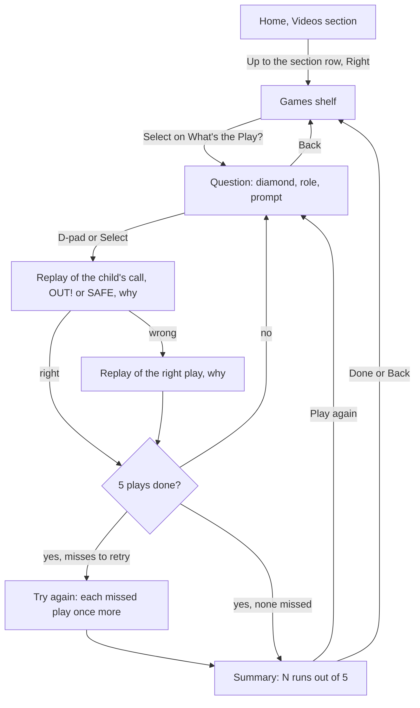
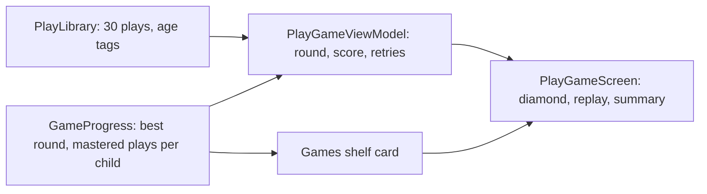

# Design: What's the Play?

- **Date:** 2026-10-26
- **Status:** Accepted

## Intent

The Baseball IQ videos ([0008](../0008-baseball-iq-videos/spec.md)) explain how to think
in a game, but a child only watches them. The owner wants children to practice those
calls: read a game situation, make the right call with the remote, earn a score for it,
and learn from a mistake rather than be punished for it. It has to be interactive and
fun to look at.

This spec adds the app's first game, "What's the Play?", and a new Games section beside
Videos. The owner expects more features soon, so the sections are built to take more
entries.

## Goals

1. Home gains a section row at its top, **Videos** and **Games**, above the existing
   tab row. Home opens on Videos exactly as today, so reaching a video takes no extra
   presses. A later section adds one entry to the row. Sections switch when focused, as
   the skill tabs do. While Games is selected, the skill tab row and the video rows are
   hidden.
2. Games shows a shelf of game cards. "What's the Play?" is the first and, for now,
   only card. The card shows the child's best round and how many plays they have gotten
   right out of the plays in their pool ("Best 4 of 5 · 12 of 15 plays").
3. A round is 5 plays. Each play draws a top-down diamond showing the outs, the runners,
   where the ball is, and one line naming the child's role and the question ("Ground
   ball to you at shortstop. Where do you throw?").
4. The child answers with the D-pad: **Up** 2nd, **Right** 1st, **Left** 3rd, **Down**
   home, **Select** hold the ball (or, for a runner, stay put).
5. After the answer an animated replay plays on the diamond: the ball flies to the
   chosen base, runners run or slide, and an **OUT!** or **SAFE** stamp lands, followed
   by a one-line why ([wrong answers](#wrong-answers) covers what a wrong call shows). A
   wrong answer then replays the right play automatically, with its
   why, so the child never has to look for it.
6. Each right first answer scores a run on a ballpark scoreboard. Wrong answers take
   nothing away.
7. A round ends on a summary ("4 runs out of 5") with **Play again** and **Done**.
8. Each child's best round and the set of plays they have ever gotten right are saved,
   so a green check marks every play they have mastered.
9. Plays are picked from the child's age range. Basics suit ages 7 and up; game
   situations suit 10 and up.
10. Everything works by remote alone, focus returns sensibly after Back, and the new
    user path (Home to Games to a full round and back) joins the acceptance suite.

## Non-goals

- Streaks, daily goals, timers, leaderboards, or any comparison between children
  ([product vision](../../../AGENTS.md#what-dugout-tv-is): no daily pressure).
- Levels, unlocks, or anything a child must grind to reach.
- Sound effects or music.
- Parent controls for games (turning games off, resetting game progress, choosing
  plays). Parent settings are unchanged.
- Plays for ages 4 to 6, or tee ball rules.
- Rundowns, the infield fly rule, and any play whose right answer is not a single base
  or hold.
- A second game. The shelf is built for more, but only one ships.
- My List, which stays as it is on the tab row.

## Decided by the owner

- A score that counts up inside a round, a saved best round, and green checks per play.
  No streaks, and wrong answers cost nothing.
- The field is drawn top-down, like a coach's whiteboard, so each arrow points at its
  base ([mockup choice A](#the-question-screen)). The fun comes from the replay
  animation.
- A Videos and Games section row at the top of Home, rather than a "pick what to do"
  screen after the picker, so videos stay one press away and new sections slot in.
- We write the situations ourselves. Nothing is copied from the books that inspired
  0008.

## How a round works

- The round draws 5 plays from the child's pool: plays without a green check first, in
  random order, then checked plays to fill. A child who has mastered every play still
  gets a full round.
- After the fifth play, each missed play comes back once under a "Try again" banner. A
  right answer there earns the green check but no run, so the score stays out of 5.
- After a replay, the why stays on screen until the child presses Select ("Next play").
- Back during a round returns to the Games shelf. The round is dropped, but checks
  already earned are kept and a best round only saves when a round finishes.

### The question screen

The layout follows option A of the
[question screen mockup](../../mockups/whats-the-play-mockup.html), and the section row
follows option A of the [sections mockup](../../mockups/sections-mockup.html): the diamond fills the centre, the scoreboard
(play N of 5 and runs) sits top left, the outs top right, the role and question on the
left, and a gold hint by each base names its D-pad direction (`▲ 2nd`, `▶ 1st`,
`3rd ◀`, `▼ Home`, `● Hold it`). Colours come from `ui/theme/Color.kt`, with a grass
green and an infield dirt brown added there.

Plays where the child is a runner show the child's runner highlighted and the prompt
"Where do you go?". Select means stay on the base; a direction means run to that base.
In the replay, a tag-up holds the runner on the base until the catch, then runs.

### Wrong answers

Only the right answer of each play is written out in full. Every wrong answer follows
one default, and a play overrides it only where baseball gives a clear result:

- **Default:** the replay shows the ball thrown (or the runner going) where the child
  chose, everyone else safe, and a **NO PLAY** stamp with "Not this time. Here's the
  play." The right play then replays with its why, which carries the lesson.
- **SAFE override:** a throw to a base where a runner beats it, such as a throw to third
  that needs a tag on play 5.
- **OUT! override:** a runner who goes where they are put out, such as running to third
  on play 13, or a forced runner who stays put on plays 12 and 30.

The plan lists the overrides per play. The owner reviews the right answers, not every
wrong one.

## The plays

Positions: P pitcher, C catcher, 1B, 2B, SS, 3B, LF, CF, RF. The answer column uses
the D-pad mapping. Each play names its role, the outs, the runners, where the ball goes,
the answer, and the why shown after the replay.

### Basics (ages 7 and up)

| # | You are | Outs | On base | What happens | Answer | Why |
|---|---|---|---|---|---|---|
| 1 | SS | 0 | none | Ground ball to you | 1st | Only the batter is running. Get the sure out at first. |
| 2 | SS | 1 | 1st | Ground ball to you | 2nd | The runner on first is forced. Get the lead runner. |
| 3 | SS | 2 | 1st | Ground ball to you right by second | 2nd | Step on second for the force. That's three outs. |
| 4 | P | 0 | loaded | Ground ball back to you | Home | Every runner is forced. The out at home stops a run. |
| 5 | SS | 0 | 2nd | Ground ball to you | 1st | The runner on second is not forced, so third needs a tag. Take the sure out. |
| 6 | 2B | 2 | 3rd | Ground ball to you | 1st | Out at first is the third out, so the run does not count. |
| 7 | 3B | 0 | 1st, 2nd | Ground ball to you right by third | 3rd | The runner from second is forced. Step on third. |
| 8 | P | 1 | 1st | Bunt in front of you | 1st | Take the sure out on a bunt. |
| 9 | 1B | 0 | 1st | Line drive caught by you; the runner was leading off | 1st | He has to get back. Step on first for a double play. |
| 10 | CF | 0 | 1st | Fly ball caught by you; the runner ran on contact and is near second | 1st | He left too early and must go back. Throw behind him. |
| 11 | SS | 1 | 2nd | Pop fly caught by you; the runner stayed | Hold | Nobody can be put out. Run the ball back to the pitcher. |
| 12 | Runner on 1st | 1 | you | Ground ball to the second baseman | 2nd | You're forced. The batter needs first base, so you must run. |
| 13 | Runner on 2nd | 0 | you | Ground ball to the shortstop, in front of you | Hold | Don't run into an out on a ball hit in front of you. |
| 14 | Runner on 3rd | 1 | you | Deep fly ball to center | Home | Tag up: stay on third until the catch, then run home. |
| 15 | Runner on 2nd | 2 | you | Base hit to the outfield | Home | With two outs, run as soon as the ball is hit and score. |

### Game situations (ages 10 and up)

| # | You are | Outs | On base | What happens | Answer | Why |
|---|---|---|---|---|---|---|
| 16 | 2B | 0 | 1st | Ground ball to you | 2nd | Start the double play: second, then first. |
| 17 | SS | 1 | 1st, 2nd | Ground ball to you | 2nd | Turn two at second and first to end the inning. |
| 18 | 3B | 2 | loaded | Ground ball to you right by third | 3rd | Closest force. Step on third, three outs, no run. |
| 19 | 1B | 0 | 3rd | Ground ball to you; the runner breaks for home | Home | The runner left early. Throw home to stop the run. |
| 20 | LF | 0 | none | Base hit to you | 2nd | Throw ahead of the runner so the batter stays at first. |
| 21 | RF | 1 | 2nd | Base hit to you; the runner will score easily | 2nd | The run is in. Keep the batter from reaching second. |
| 22 | LF | 1 | 3rd | Shallow fly ball caught by you; the runner tags | Home | Throw home to beat the runner tagging up. |
| 23 | RF | 0 | 2nd | Fly ball caught by you; the runner tags for third | 3rd | Throw to the base the runner is going to. |
| 24 | P | 0 | 2nd | Ground ball back to you | 1st | Look the runner back to second, then take the out at first. |
| 25 | RF | 0 | none | Ground ball to the shortstop | 1st | Back up first in case the throw gets past. |
| 26 | P | 1 | 2nd | Base hit to right; the runner heads home | Home | Back up home behind the catcher. |
| 27 | CF | 0 | 1st | The runner steals; the catcher throws to second | 2nd | Back up second in case the throw gets away. |
| 28 | C | 1 | 1st, 3rd | The runner on first steals second | Hold | A throw to second lets the run score. Look the runner back to third. |
| 29 | Runner on 2nd | 1 | you | Deep fly ball to right | 3rd | Tag up, then take third after the catch. |
| 30 | Runner on 1st | 0 | you | Ground ball to the shortstop | 2nd | You're forced, so run hard to second. |

Plays 25 to 27 are backing up: the child answers with the base they run behind, and the
replay shows them going there rather than a throw.

## How it fits

- A new `game/` package holds the play model, the bundled `PlayLibrary`, the round
  logic, the ViewModel, and the screens, following the `picker/` slice.
- The play model stores positions on the diamond so the replay can be drawn from data:
  where the ball starts, each runner's start and path, the throw or run for each answer,
  and whether each answer ends in OUT! or SAFE.
- Game progress is per child and saved in Room: the best round (runs out of 5) and the
  IDs of mastered plays. This is a new entity, so the database moves to version 4 with
  a tested migration from 3 (ADR-0007). Removing a child removes their game progress.
- Home's ViewModel gains the selected section. The Games shelf reads the child's game
  progress for its card.

## Builder's calls (the owner may override)

- Wrong answers use a NO PLAY default with SAFE or OUT! overrides only where baseball is
  clear, so each play needs one written lesson rather than one per answer.
- Play 15 answers Home (score from second with two outs), corrected from 3rd during
  review.
- The card counts plays out of the child's pool, so a 7 to 8 child sees "of 15" and can
  finish it.
- **The 30 plays above**, their wording, and their answers. The owner should check the
  answers they would coach differently (28, first and third, has more than one sound
  answer; this one is the safe youth call).
- Ages: basics 7 to 18, situations 10 to 18, matched against the child's age range as
  videos are. A 9 to 10 child gets both pools; a 4 to 6 child gets no plays, so the
  section row hides for them and Home looks as it does today.
- After the fifth play, missed plays come back once each as "Try again" for a check but
  no run, which keeps the score out of 5.
- The replay runs about 3 seconds, and the why waits for Select rather than moving on by
  itself, so a slow reader is never rushed.
- Back from the Games shelf goes to the section row's Games entry, then Back again
  behaves as Back from Home does today.
- Grass green and dirt brown join `Color.kt`.

## Left to the builder

- How the replay animates (Compose `Canvas` with animated progress is the expected
  route), and the exact geometry of the diamond.
- Whether the play library lives in Kotlin like `VideoLibrary` (expected) or a bundled
  file.
- Checking the diamond, labels, and the section row fit a 1080p TV, with a
  native-graphics Robolectric test where text width matters.
- Any play whose replay cannot be drawn clearly may be reworded or replaced with one of
  the same idea, noted in the plan.
