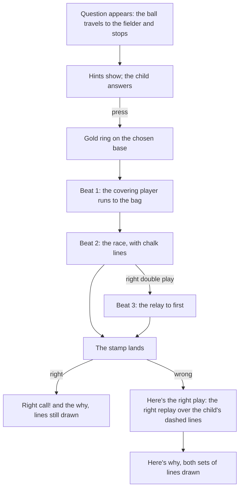

# Design: Replays a child can follow

- **Date:** 2026-10-26
- **Status:** Accepted

## Intent

The owner's children played What's the Play? ([0009](../0009-whats-the-play/spec.md)) on
the TV and had trouble following the replay. Everything moves at once: the ball, every
runner, and the covering fielder start together, travel at one steady speed, and arrive
together, so the OUT! or SAFE stamp decides the result rather than anything the child
saw. The replay also opens by jumping the ball back to home plate, so for over a second
after a press nothing shows which base the child chose. When the replay ends, nothing
is left on the field to read the why against.

This spec reworks the replay so a 7 year old can follow it with their eyes: one thing
moves at a time, the race that decides the play is visible, and the play stays drawn on
the field while the why is read. Rounds, scoring, the plays, and saved progress do not
change.

## Goals

1. **The hit belongs to the question.** When a question appears, the ball travels from
   home plate to where it is fielded (or caught), then stops. The child answers from that
   frozen moment. The replay starts from there; the ball never jumps back to home plate.
2. **The press shows at once.** The moment the child answers, a gold ring circles the
   chosen base (none for Hold) and stays for that replay.
3. **The replay runs in beats, one idea at a time.**
   - **Beat 1, the set-up:** the fielder who will take the throw runs to the bag. On a
     covering play the child is that fielder; on a back-up the child runs behind the
     base.
   - **Beat 2, the race:** the throw (or the child's run with the ball, or the child's
     own run as a runner) races the runner heading to the same base.
   - **Beat 3, the relay**, on a right double play only: the ball goes on to first.
   - Then the stamp lands.
4. **The race is earned on screen.** On OUT! the ball reaches the base first and the
   runner arrives a step late. On SAFE (and NO PLAY) the runner arrives first or the
   ball goes where no out is made. Throws ease out, runners ease in and out; nothing
   moves at one steady speed.
5. **Only the play is bright.** During the replay and the why, the players and runners
   not in the play fade back. The child's player, the ball, the covering player, and the
   runners racing to a base the play targets stay bright. Nothing fades while the
   question is asked, so the child can read the whole situation.
6. **Chalk lines draw the play.** The throw, the covering player's run, the child's own
   run, and each racing runner leave a chalk line as they move, ending in an arrowhead.
   The lines stay on the field while the why shows.
7. **A wrong answer stays beside the right one.** After a wrong call, the child's lines
   stay on the field as a faded, dashed gold line while the right play replays over them
   in solid chalk. A "Here's the right play" banner shows for the whole right-play replay,
   replacing today's message that shows only briefly. The child's call shows "Not this
   time." once its stamp lands.
8. **The stamp lands.** It scales down from larger with a small overshoot, settles at a
   slight tilt, and sits in a rubber-stamp border, as in the mockup.
9. **Runners move as the play describes.** Where a play's words have a runner off the
   bag, tagging up, or running without being forced, the replay shows it, and every
   OUT! or SAFE (right or wrong answer) comes from a race the child can see. Plays whose
   data cannot show this gain runner movement data: at least plays 9 and 10 (runners off
   the bag), 15 (the child's run against a throw), 19, 21, 22, 23, and 26 (runners who
   run unforced), and the wrong-answer stamps on 5, 6, 12, and 30. Answers and why lines
   do not change.
10. A replay stays about as long as today's (about 3 seconds before the stamp holds). A
   double play may run a little longer for its third beat.

## Non-goals

- Labels on the fielders, changes to the hints, larger text, a line-score summary, or a
  "New best!" note (raised in the same review; each can follow on its own).
- Sound.
- Changes to rounds, scoring, Try again, the plays' answers and why lines, or saved
  progress. No Room change. Plays gain movement data only (goal 9).
- A way for the child to watch a replay again.
- Drawing fly balls differently from ground balls.

## Decided by the owner

- The "one thing at a time" option (B) of the
  [replay mockup](../../mockups/replay-beats-mockup.html), over today's replay (A).
- Rounds, scoring, and progress stay as they are.
- Plays gain runner movement data where their words describe runners the replay does
  not show today, rather than limiting races to what the current data supports.

## How a play now looks

How the beats read for each kind of play (the builder may adjust timing):

| Kind | Beat 1 | Beat 2 | Beat 3 |
|---|---|---|---|
| Throw (most plays) | Covering player to the bag | Throw races the runner to that base | Relay to first, right double plays only |
| Take it yourself (3, 7, 9) | Nothing | Child runs to the bag with the ball, racing the runner | Relay to first on a right double play |
| Runner (12 to 15, 29, 30) | Nothing | Child's run, racing the throw when there is one | None |
| Back-up (25 to 27, 33) | Child runs behind the base | The throw arrives | None |
| Covering (31, 34 to 36) | Child runs to the bag | The throw to the child | None |
| Hold (11, 28, and runner holds) | Nothing | Runners who must run go; the ball stays | None |

A beat with nothing to show is skipped rather than left as a pause.

## Builder's calls (the owner may override)

- Presses are ignored until the ball reaches the fielder and the hints show. This
  replaces the 300 ms settle on a new question, which only guarded a fast double tap
  and is shorter than the hit.
- The gold ring marks the child's base during their own replay. During the right-play
  replay it moves to the right base.
- Fading stays through the why, so the chalk lines read clearly.
- Forced runners who are not racing to the target base still run, faded, in beat 2, so
  the field ends where it would in a real play.
- Tag-ups read naturally from goal 1: the question freezes at the catch, and the
  runner leaves the bag in beat 2.
- Whoever holds the ball stays bright while they throw, even when it is not the child
  (on covering, back-up, and runner plays).
- A wrong answer on a covering play sends the child to the base they chose while the
  ball is thrown where the play needs it, to an empty bag. A wrong answer on a back-up
  sends the child behind the base they chose while the throw goes to its usual base with
  nobody behind it. Either way the empty spot is the lesson, and the right replay fills
  it.

## Left to the builder

- Exact beat lengths, easing curves, and how far ahead the winner of a race arrives.
- How the replay's timing is modelled (for example, a list of timed moves per play
  computed from the play's data) and where the drawing reads it. Reading the replay's
  progress inside the draw phase, so the left-hand column does not recompose every
  frame, is welcome but not required.
- Chalk line weight, dash pattern, arrowhead size, and fade level, checked on a 1080p TV.
- Updating the Robolectric and acceptance tests for the new timing: the answer now waits
  for the hit, and replays are timed in beats.
