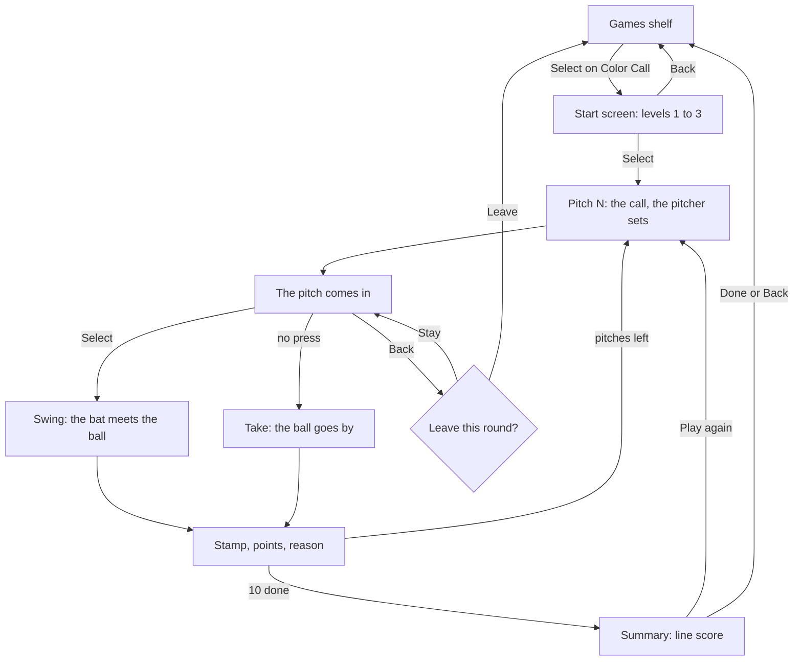
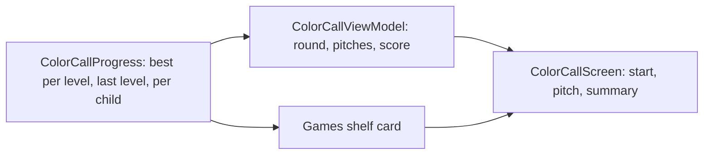

# Design: Color Call

- **Date:** 2026-11-08
- **Status:** Draft

## Intent

The owner's training plan for their players names four areas where travel players are
ahead at 9 and 11. Handling faster pitching comes first, and part of it is pitch
recognition: deciding early whether to swing. The plan's home drill for this is **color
call**. Practice balls are marked blue, orange, or black. A parent front-tosses and calls
one color, and the hitter swings only at that color and takes the other two.

What's the Play? ([0009](../0009-whats-the-play/spec.md)) already covers Baseball IQ.
This spec adds a second game, Color Call, that brings the color call drill to the TV with
one button: **Select** swings, and doing nothing is a take. It scores the same way the
drill does, so a round on the TV and a round in the yard count alike, and the app works as
a warm-up for the real drill.

The [mockup](../../mockups/color-call-mockup.html) is playable in a browser and shows the
pitch, the stamps, and the round summary.

## Goals

1. The Games shelf gains a second card, **Color Call**, after What's the Play?. It shows
   the child's best round at the level they played last ("Best 8 of 10 · Level 2"), or
   "New" before a first round.
2. Selecting the card opens a **start screen** with the three levels as a row of choices
   and a line under each saying when the call comes. Focus starts on the level the child
   played last, or the first time on a level picked from their age (level 1 for 7 to 10,
   level 2 for 11 to 12). Select starts a round at the focused level. Every level is
   always open to every child.
3. A round is **10 pitches**. Each pitch shows a **call** in a banner at the top ("SWING
   AT" with a ball and the color name), then a pitch comes in from the mound toward the
   plate and grows as it approaches. The ball is half white and half blue, orange, or
   black, like the marked practice balls.
4. The child swings by pressing **Select** while the ball is in flight and the call is
   showing. A press counts as a swing no matter when it lands in that window, and the bat
   meets the ball on its own, so the remote's input lag can never cost a point. Not
   pressing is a take. A press before the call shows (at levels 2 and 3) is ignored, so
   the first press after the call is the swing.
5. Each pitch scores by the drill's rules:

   | Pitch | The child | Stamp | Points |
   |---|---|---|---|
   | Called color | Swings | NICE SWING | +1 |
   | Another color | Takes | GOOD TAKE | +1 |
   | Another color | Swings | CHASED | −1 |
   | Called color | Takes | THAT WAS YOURS | 0 |

   The round total never goes below 0. The stamp lands beside the plate with its points
   and a one-line reason ("It was orange, not blue.").
6. **Levels** set when the call appears, and pitches get a little faster at each level:
   - Level 1: before the pitch, while the pitcher sets.
   - Level 2: as the ball leaves the pitcher's hand. Until then the banner shows "? ? ?".
   - Level 3: a third of the way through the flight.
7. The round ends on a **summary**: "N points out of 10", the best round at this level,
   and a line score with one column per pitch (the call, the ball, swing or take, and the
   points). **Play again** is focused; **Done** returns to the Games shelf.
8. Each child's best round per level, and the level they last played, are saved.
9. Everything works by remote alone. Focus returns to the Color Call card after Done or
   Back, and the new path (Home to Games to Color Call to a full round and back) joins the
   acceptance suite.

## Non-goals

- Unlocks, or any level a child must earn ([0009](../0009-whats-the-play/spec.md#non-goals)
  rules them out; the owner confirmed for this game).
- Streaks, daily goals, timers, leaderboards, or comparing children.
- The plan's harder variants: two colors to swing at, and "only if it's a strike". A
  later spec can add them as levels 4 and 5.
- Judging swing timing, aiming the swing, or using the D-pad during a pitch.
- Sound effects or music.
- Parent controls for games, and any change to parent settings.
- Ages 4 to 6, who see no Color Call card (the same as What's the Play?).

## Decided by the owner

- Color Call is the next game, built from the plan's color call drill.
- There are no unlocks: the child chooses the level.
- A chase costs a point, matching the drill, unlike a wrong answer in What's the Play?.
- Ages 7 to 8 get the game, starting at level 1.
- A press before the call shows is ignored, so the child must see the color before
  swinging. Mashing Select then plays as always swinging, which loses points on chases.
- The look follows the playable mockup: a batter's-eye view toward the mound, the call
  banner at the top, and a line-score summary.

## How a round works

- Each pitch picks the called color at random, then the ball: the called color about
  45% of the time, otherwise one of the other two. Over a round both swings and takes
  come up, and a child who never swings scores about half.
- A pitch has four beats: the set (about 1 second, the call shows here on level 1), the
  windup (about half a second), the flight (about 1.5, 1.35, and 1.2 seconds at levels 1
  to 3), and the stamp (about 2.5 seconds). The next pitch then starts by itself.
- On a swing, the bat starts in time to meet the ball near the plate even if the press
  came early, and a hit ball flies back out toward the field. A press after the ball has
  reached the plate is ignored.
- Back during a round asks before leaving, the same check What's the Play? uses. The
  round is dropped, and a best round only saves when a round finishes.

## The pitch screen

The layout follows the [mockup](../../mockups/color-call-mockup.html):

- A night field seen from the batter's box: the outfield fence, the mound with the
  pitcher, the plate at the bottom, and a faint dashed strike zone over the plate.
- The batter's bat rests on the right edge and sweeps across on a swing.
- Top left: "PITCH N OF 10" with ten pips that fill green (+1), red (−1), or grey (0).
  Top right: points. Top centre: the call banner.
- Bottom left: a remote hint ("● SELECT swing · NOTHING take").
- The stamp sits left of the plate, where it cannot cover the ball.

Ball colors are blue, orange, and black on a white half, never red or green, since about
1 in 12 boys cannot tell those apart. Colors come from `ui/theme/Color.kt`, which gains
the three ball colors.

## How it fits

- A new `colorcall/` package holds the pitch model, the round logic, the ViewModel, and
  the screens, following the `picker/` slice. Round logic is pure Kotlin that takes its
  random source as a parameter, so tests choose the pitches.
- The screen times each beat with an animation and reports when it ends, as the replay
  does in What's the Play?. The ViewModel decides what each report means, so tests can
  drive a pitch by sending those reports instead of waiting on real time.
- Saved progress is per child: the best round for each level and the last level played.
  It is a new Room entity, so the database moves to version 5 with a tested migration
  from 4 (ADR-0007). Removing a child removes their Color Call progress.
- The Games shelf becomes a row of two cards. Home's ViewModel reads Color Call progress
  for the second card's line, and focus returns to whichever card the child left from.

## Builder's calls (the owner may override)

- A press anywhere in the flight once the call shows is a swing, and the bat times itself. The game tests the
  decision, not reflexes.
- The stamp stays about 2.5 seconds and the next pitch starts by itself, so the rhythm
  feels like the drill. The reason line is short enough for a 7 year old to read in that
  time. The summary waits for the child.
- 10 pitches a round, and about 45% of pitches match the call.
- The round total floors at 0 after every pitch, so the points on screen never read
  below 0 and a chase at 0 leaves it at 0. The pip still fills red and the line score
  still shows −1 for that pitch. The saved best is the total as shown.
- The first level picked from age: level 1 for 7 to 10, level 2 for 11 to 12.
- The last level played is saved when a round starts, so a child who picks level 3 and
  leaves finds level 3 focused next time. If that level has no finished round, the card
  reads "New · Level 3".
- The card shows the best round at the last level played, not across all levels, since
  scores at different levels do not compare.

## Left to the builder

- How the field, pitcher, ball, and bat are drawn (Compose `Canvas` with animated
  progress, as the diamond is) and their exact geometry.
- Exact beat lengths within the ranges above, tuned on the TV.
- Checking the banner, stamps, and line score fit a 1080p TV, with a native-graphics
  Robolectric test where text width matters.
- The start screen's layout, keeping it to one row of three level choices with Select to
  start.
